University: ITMO University<br />
Faculty: FICT<br />
Course: Network Functions Virtualization<br />
Year: 2026/2027<br />
Group: K3421<br />
Author: Stafeev Ivan Alekseevich<br />
Lab: Lab4<br />
Date of create: 05.11.2026<br />
Date of finished: 05.11.2026<br />

# Лабораторная работа №4. SDN: OpenFlow 1.3, Open vSwitch и контроллер OpenDaylight

**Цель работы:** освоить принципы построения и настройки программно-конфигурируемых сетей с разделением плоскостей управления и данных, используя коммутаторы Open vSwitch и контроллер OpenDaylight, управляемые по протоколу OpenFlow 1.3 и интерфейсу RESTCONF.

Для достижения цели были поставлены следующие задачи:

1. развернуть тестовую SDN-топологию в среде Containerlab, включающую контроллер OpenDaylight, коммутаторы Open vSwitch и конечные хосты;
2. обеспечить подключение коммутаторов к контроллеру по протоколу OpenFlow 1.3 и изучить инвентарь сетевых устройств через RESTCONF API;
3. реализовать проактивное программирование правил пересылки через REST API для обеспечения сквозной связности между сетевыми сегментами;
4. настроить списки контроля доступа (ACL) с помощью потоков с высоким приоритетом и проанализировать статистику обработки трафика на контроллере и коммутаторе;
5. исследовать поведение сети, механизмы отказоустойчивости и восстановления правил при потере связи с контроллером в режимах `secure` и `standalone`.

---

# Топология и контроллер

Вначале в корне репозитория был создан рабочий каталог `lab4`, а также в корень перенесен каталог `images`, содержащий Dockerfile'ы используемых в работае образов. На рисунках 1 и 2 показана сборка трех Docker-образов: универсальный образ для хостов и VNF, образ для коммутатора и образ для контроллера.

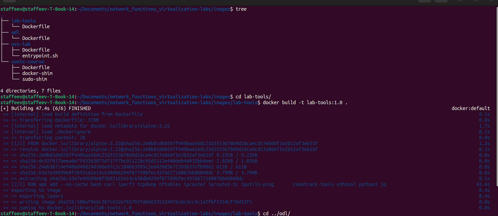

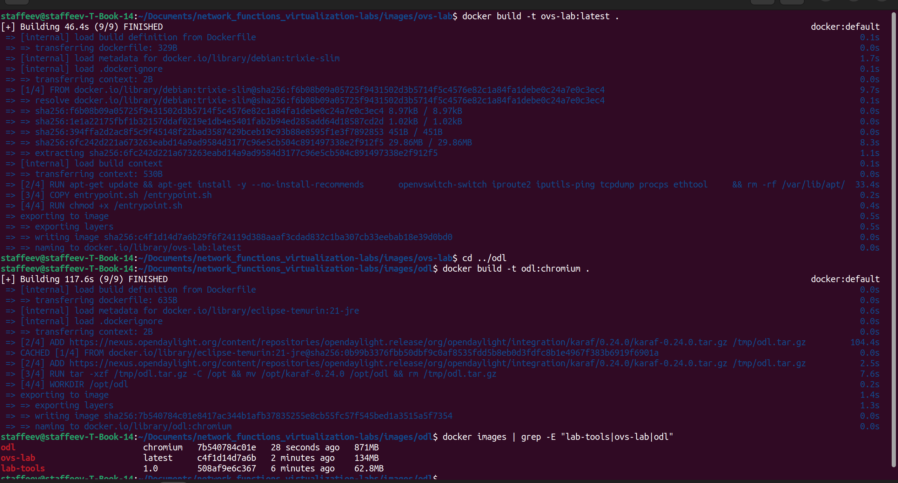

В нижней части рисунка 2 виден также вывод собранных образов, где видны требуемые в работае образы.

Далее в рабочем каталоге был создан yml-файл конфигурации сети, а также экспортированны переменные `STUDENT=stafeev` и `N=26`. Схема сети выглядит следующим образом:

```
             [ ODL ]
            /       \
          / OF 1.3    \
        [ s1 ]-------[ s2 ]
          |             | \
          |             |  \
         [h1]          [h2] [h3]
         .4.1          .4.2 .4.3
```

На рисунке 3 показан успешный deploy сети в среде Containerlab.

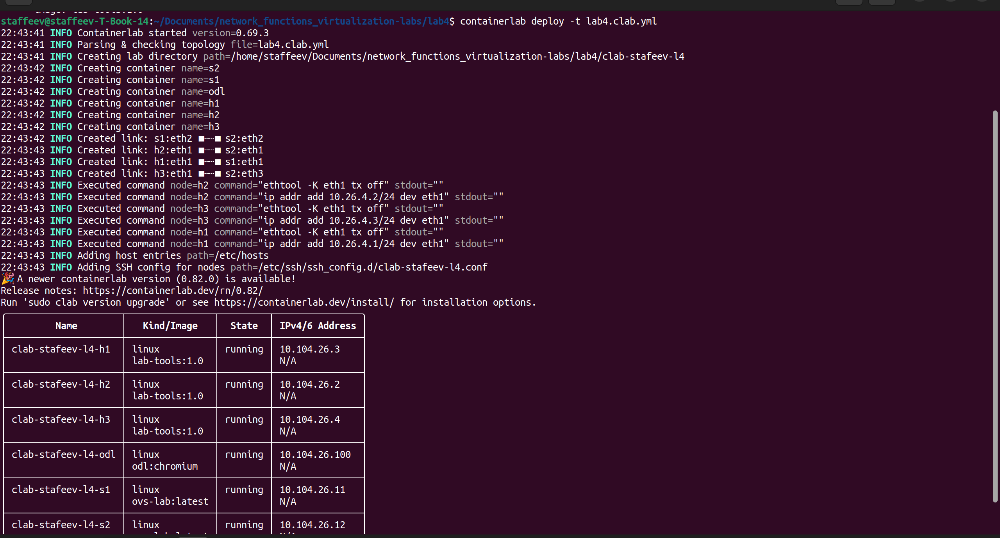

В yml-конфигурации отдельно создается сеть управления (mgmt), и коммутаторы связаны с контроллером именно черехз эту сеть (eth0). Эта схема называется внеполосным управлением (Out-of-Band Management). В производственных средах ее предпочитают внутриполосному управлению по следующим причинам:

- Надежность и изоляция. Трафик управления отделен от пользовательского трафика. В случае перегрузки каналов или ошибок конфигураци канал управления остается доступным для диагностики и восстановления.
- Безопасность. Выделенная сеть позволяет строго контролировать доступ к критической инфраструктуре (REST API, SSH), не смешивая политики безопасности с правилами пересылки данных.
- Независимость от плоскости данных. При использовании `fail-mode=secure` коммутатор отбрасывает пакеты без явных правил. Без выделенного канала управления контроллер не смог бы установить соединение для загрузки начальной конфигурации.

Далее в контроллере были установлены три модуля (рисунок 4). `odl-openflowplugin-flow-services-rest` предоставляет RESTCONF-интерфейс для управления потоками в коммутаторах по протоколу OpenFlow; `odl-openflowplugin-app-table-miss-enforcer` гарантирует наличие правила "table-miss" (правила по умолчанию с приоритетом 0) в таблицах потоков коммутаторов; `odl-restconf-openapi` активирует RESTCONF API, позволяя управлять конфигурацией сети через HTTP-запросы. После установки была выполнена проверка активности модулей и доступности сетевых портов 6653 (OpenFlow 1.3) и 8181 (RESTCONF API).

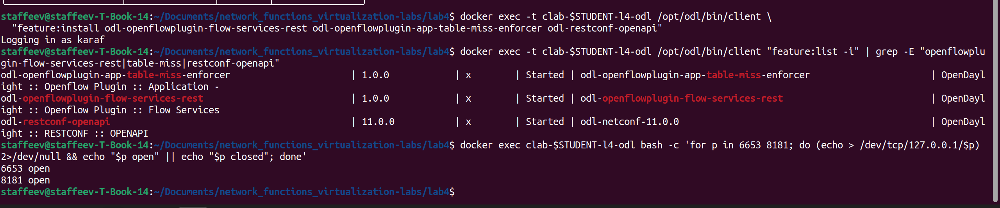

Модуль `table-miss-enforcer` автоматически устанавливает на все подключенные коммутаторы правило по умолчанию (table-miss) с минимальным приоритетом 0, которое перехватывает любой трафик, не подошедший под явно заданные правила, и отправляет его на контроллер (действие `CONTROLLER:65535`). Это нужно для обеспечения безопасности и предсказуемости работы сети. Механизм гарантирует, что коммутатор не будет произвольно дропать или пересылать неизвестные пакеты.

После для упрощения работы с RESTCONF API были созданы три bash-функции: 1) `odl_get()` - выполняет GET-запросы к контроллеру для получения информации о сети; 2) `put_flow()` - отправляет PUT-запросы для создания или обновления правил пересылки в коммутаторах; 3) `del_flow()` - выполняет DELETE-запросы для удаления правил из коммутаторов. На рисунке 5 показано создание этих функций, а также вызов `odl_get()` для запроса инвентаря узлов (функция вернула `data-missing`, так как данные об узлах пока отсутствют, но главное, что функция работает).

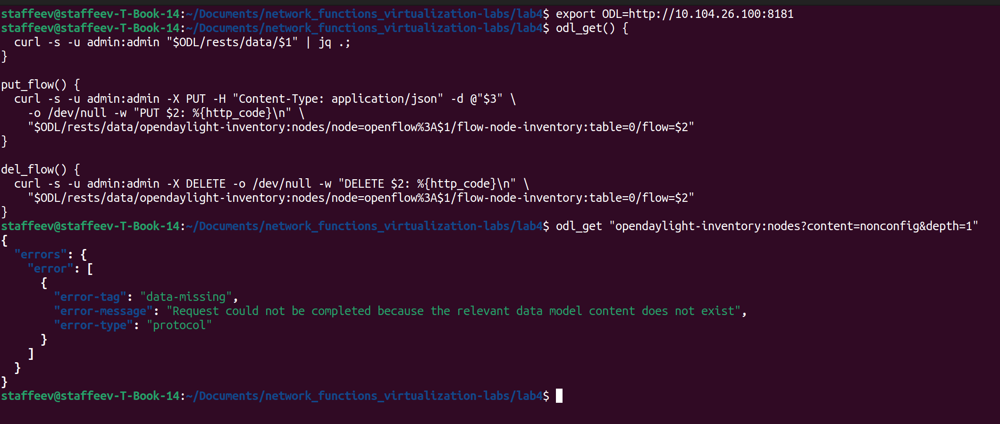

---

# Подключение коммутатора

Для автоматической настойки Open vSwitch-коммутаторов был создан скрипт `ovs-setup.sh` (рисунок 6). Скрипт создает мост br0 в userspace-режиме с протоколом OpenFlow 1.3 и режимом безопасности `fail-mode=secure`, который дропает весь трафик при отсутствии правил или потере связи с контроллером. Скрипт задает уникальный идентификатор коммутатора (datapath-id) из переменной DPID, отключает in-band управление, чтобы контроллер подключался только через выделенный management-интерфейс, и добавляет в мост доступные интерфейсы eth1–eth3 с явным назначением номеров OpenFlow-портов и отключением TX-offload. В завершение скрипт указывает коммутатору подключиться к контроллеру OpenDaylight по адресу ODL_IP:6653 и выводит итоговую конфигурацию для проверки.

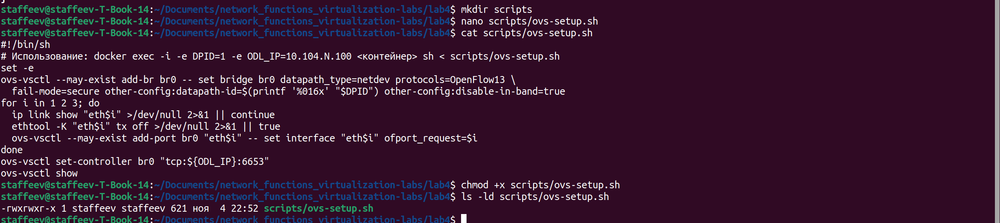

Созданный скрипт был применен к коммутаторам (рисунок 7). В выводе видно, что на s1 создался мост br0 с портами eth1 и eth2, а на s2 - с портами eth1, eth2 и eth3. На обоих коммутаторах указан контроллер `tcp:10.104.26.100:6653` и режим `fail_mode: secure`.

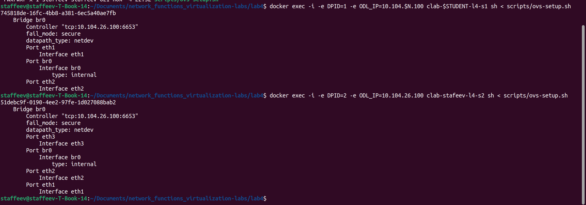

Были выполнены некоторые команды для проверки подключения (рисунок 8). Можно увидеть, что коммутатор s1 подключен к контроллеру (вывод первой команды проверки - `is_connected: true`), по коммутатору есть подробный вывод (dpid равен заданному, интерфейсы eth1 и eth2 в состоянии LIVE). 

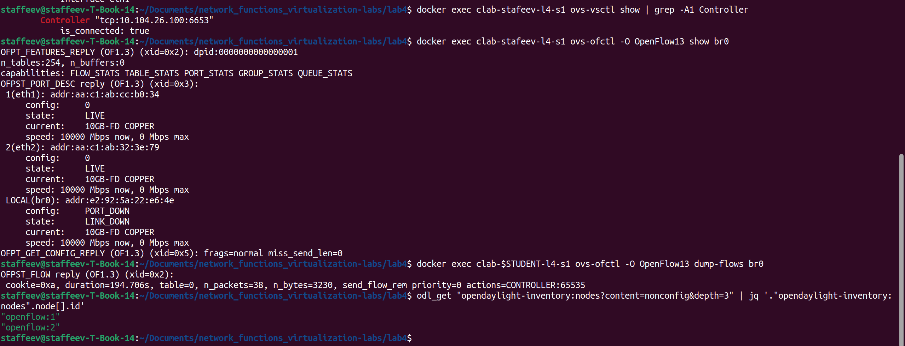

Третья команда - просмотр текущих правил. В таблице потоков пока одно правило - table-miss, которое автоматически установил модуль table-miss-enforcer. Оно имеет минимальный приоритет (0), поэтому срабатывает только когда пакет не подошел ни под одно другое правило. Действие `CONTROLLER:65535` означает "отправить пакет контроллеру". Именно через это правило контроллер узнает о новых пакетах и может принимать решения.

И последнее - проверка инвентаря. В выводе есть `openflow:1` и `openflow:2`, что значит, что OpenDaylight увидел оба коммутатора и добавил их в свой operational datastore.

Несмотря на то что коммутаторы подключены к контроллеру, пинг с хоста h1 не идет (рисунок 9). В установленном режиме `fail-mode=secure`, если для пакета нет подходящего правила в таблице потоков, коммутатор его дропает. Пакеты уходят на контроллер (из-за table-miss), но сам контроллер в проактивном режиме не создает правила автоматически. Поэтому ICMP-пакеты от h1 до h2 пока не доходят.

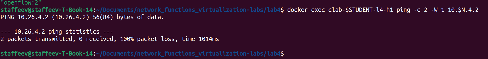

---

# Проактивная пересылка

Все правила пересылки описаны в формате JSON по схеме RESTCONF API OpenDaylight и имеют единую структуру. Корневой объект содержит массив `flow-node-inventory:flow`, в котором задаются параметры правила: id, номер таблицы потоков, приоритет (задан как 200, что выше, чем у автоматически созданного правила table-miss с приоритетом 0, чтобы наши правила обрабатывались в первую очередь), блок match с условиями срабатывания и блок instructions, где указывается номер порта для пересылки через output-node-connector.

Для коммутатора s1, к которому подключены только h1 (порт 1) и s2 (порт 2), правила простые: они различают трафик только по входному порту (in-port). После применения через функцию `put_flow` (рисунок 10) оба правила вернули HTTP-код 201 (Created), что означает их успешное создание в контроллере.

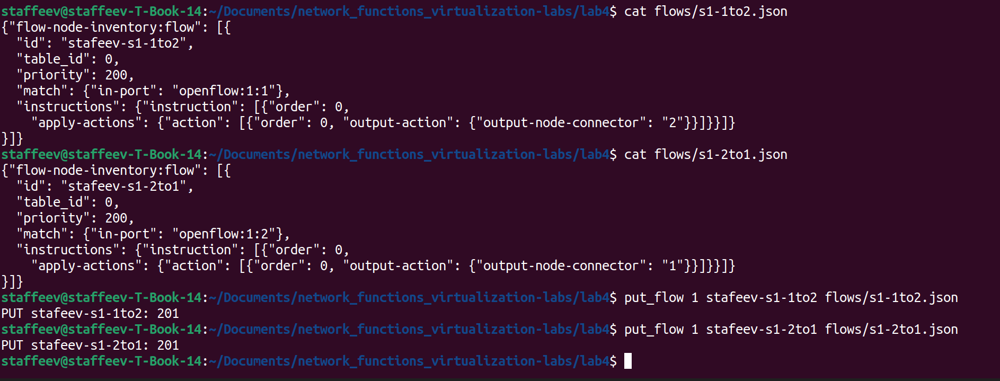

Для коммутатора s2 структура правил усложняется, поскольку к нему подключены три устройства: h2 (порт 1), s1 (порт 2) и h3 (порт 3). Для трафика, приходящего со стороны s1 (in-port: openflow:2:2), необходимо различать адресата. В блок match добавляются дополнительные поля: `ethernet-match` с типом Ethernet (2048 для IPv4, 2054 для ARP) и либо `ipv4-destination` для IP-пакетов, либо `arp-target-transport-address` для ARP-запросов. Это позволяет направить пакет к нужному хосту: правила s2-to-h2-ip и s2-to-h2-arp отправляют трафик для 10.26.4.2 на порт 1, а s2-to-h3-ip и s2-to-h3-arp — для 10.26.4.3 на порт 3. Обратный трафик от хостов к s1 описан в файлах s2-1to2.json и s2-3to2.json без фильтрации по типу пакета - весь трафик с портов 1 и 3 пересылается на порт 2. Эти 6 скриптов приведены на рисунках 11 и 12.

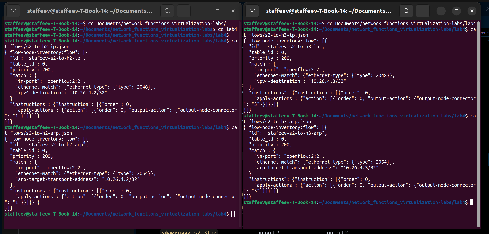

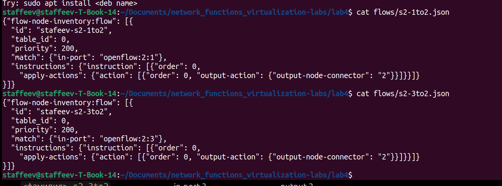

После применения всех восьми правил связность была проверена командой ping от h1 к h2 и h3, оба теста показали 0% потерь пакетов. Команда `dump-flows` на коммутаторе s2 показала наличие установленных правил с ненулевыми счётчиками `n_packets`, значит, эти правила используются. Запрос к config datastore контроллера через вернул список всех шести правил для узла `openflow:2`, что демонстрирует разделение хранилищ в OpenDaylight. Выводы команд продемонстрированы на рисунке 13.

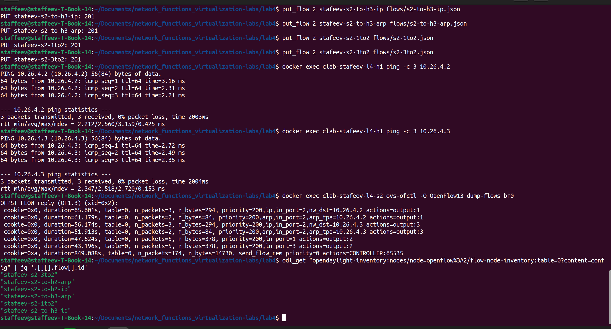

В архитектуре OpenDaylight хранилище config содержит желаемое состояние сети, заданное администратором через REST API, и выступает источником истины, тогда как operational отражает фактическое текущее состояние коммутаторов, включая служебные правила и статистику. Если удалить поток напрямую на коммутаторе командой `ovs-ofctl del-flows`, он временно исчезнет из таблицы потоков, но останется в config-хранилище контроллера. Благодаря механизму reconciliation (согласования) OpenDaylight периодически сравнивает фактическое состояние с конфигурационным, обнаружит рассинхронизацию и автоматически отправит на коммутатор сообщение Flow-Mod для восстановления удаленного правила, что делает невозможным удаление проактивного потока в обход контроллера.

---

# ACL и статистика

Для демонстрации работы ACL было создано правило блокировки ICMP-трафика от хоста h1 к хосту h3. В правиле в файле `flows/acl-icmp-h3.json` указан приоритетом 526 (выше, чем у правил пересылки с приоритетом 200, чтобы ACL срабатывал в первую очередь). В блоке match указаны условия: входной порт `openflow:1:1` (от h1), тип `Ethernet 2048` (IPv4), протокол `IP 1` (ICMP) и адрес назначения `10.26.4.3/32`. В блоке instructions указано действие `drop-action`, чтобы пакет отбрасывался. JSON правила и его успешное применение показаны на рисунке 14.

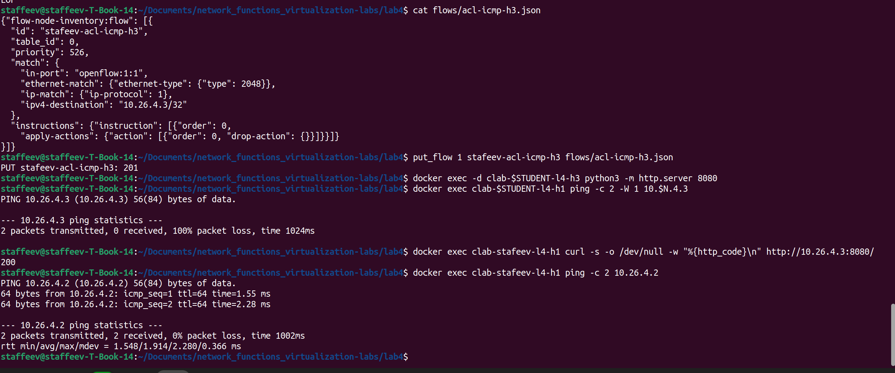

Также на хосте h3 был запущен HTTP-сервер. Пинг между h1 и h3 не отработал, ICMP-трафик действительно блокируется ACL. При этом HTTP-запрос `curl http://10.26.4.3:8080/` вернул код 200, что говорит о том, что TCP-трафик не блокируется, поскольку не попадает под условия добавленного правила. Пинг до h2, которого в правиле ACL нет, тоже срабатывает успешно.

Для получения статистики обработки правила был выполнен запрос к operational datastore контроллера (рисунок 15). Ответ показал `packet-count: 2` и `byte-count: 196` - правило обработало 2 ICMP-пакета по 98 байт каждый. Команда `dump-flows br0` на коммутаторе s1 подтвердила наличие правила с `actions=drop` и таким же счетчиком.

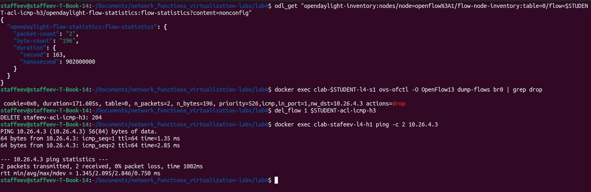

После удаления правила через `del_flow` пинг от h1 к h3 снова стал проходить без потерь.

---

# Отказ контроллера

Вначале была протестирована схема отказа контроллера при включенном `secure`. Коммутаторы потеряли связь с контроллером, однако пинг от h1 к h2 продолжал идти (рисунок 16). Проактивные проактивные правила, загруженные ранее через REST API, остались в таблицах потоков коммутаторов; режим secure не удаляет существующие правила, а лишь запрещает пересылку пакетов, для которых правил нет, поэтому пинг пошел.

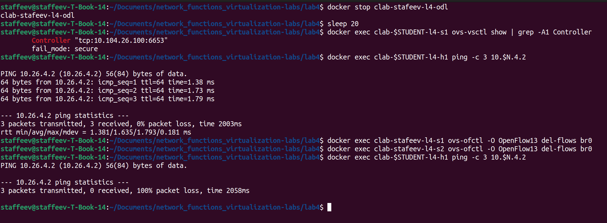

После принудительной очистки таблиц потоков командой `del-flows` на обоих коммутаторах пинг перестал проходить. Теперь режим `secure` по-честному отрабатывает: без правил и без контроллера коммутатор отбрасывает весь трафик.

После переключения обоих коммутаторов в режим `standalone` пинг от h2 к h3 снова стал проходить, хотя таблица потоков оставалась пустой (рисунок 17). В режиме standalone при потере связи с контроллером OVS переключается в режим обычного L2-коммутатора: он самостоятельно изучает MAC-адреса по заголовкам кадров и пересылает пакеты на основе внутренней MAC-таблицы, не создавая при этом явных правил OpenFlow в Table 0.

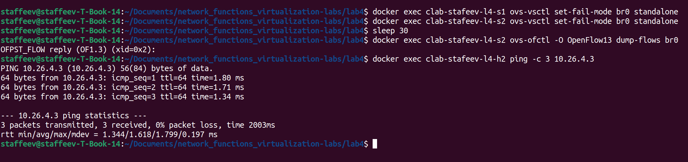

После запуска контроллера и возврата режима `secure` на обоих коммутаторах, OpenDaylight автоматически восстановил соединение и все проактивные правила на коммутаторах (они есть в выводе `dump-flows`). Успешное восстановление показано на рисунке 18.

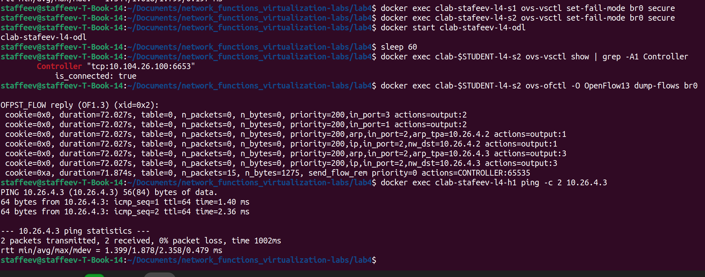

**Какой режим безопаснее, а какой надежнее?** Режим `secure` безопаснее, поскольку гарантирует, что при сбое контроллера или отсутствии правил трафик будет отброшен, что защищает от петель, утечек данных и несанкционированной пересылки. Режим `standalone` надежнее с точки зрения доступности: сеть продолжает функционировать как обычный L2-коммутатор даже при полном отказе плоскости управления, но ценой потери централизованного контроля и политик, включая ACL.

**Что такое reconciliation и восстановились ли потоки?** Reconciliation (согласование) — это механизм OpenDaylight, при котором контроллер сравнивает свое хранилище желаемой конфигурации (config datastore) с фактическим состоянием коммутатора (operational datastore). При переподключении ODL обнаруживает отсутствие правил на коммутаторе и автоматически отправляет Flow-Mod сообщения для их восстановления. В текущем эксперименте все шесть проактивных правил были автоматически восстановлены без вмешательства администратора, что подтверждается выводом dump-flows и успешным ping.

---

# Реактивная коммутация

Для удобного переключения между реактивной и проактивной коммутацией были написаны скрипты `to-reactive.sh` и `to-proactive.sh` (оба можно посмотреть в [репозитории](https://github.com/staffeev/network_functions_virtualization-labs/tree/main/lab4/scripts)).

Скрипт `to-reactive.sh` отключает коммутаторы от контроллера, перезапускает OpenDaylight, устанавливает модуль `odl-l2switch-switch-rest` (приложение L2Switch для реактивного обучения MAC-адресов), переподключает коммутаторы и генерирует тестовый ping для инициализации MAC-таблицы. Скрипт `to-proactive.sh` аналогично перезапускает контроллер, но устанавливает проактивные фичи и применяет все JSON-правила из папки `flows/`.

Запуск скрипта `to-proactive.sh` показан на рисунке 22. Там же показан вывод `dump-flows` для дальнейшего сравнения.

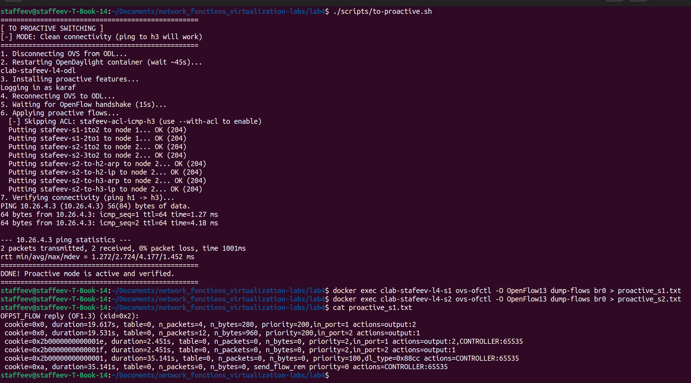

Запуск скрипта `to-reactive.sh` и вывод `dump-flows` показаны на рисунке 21.

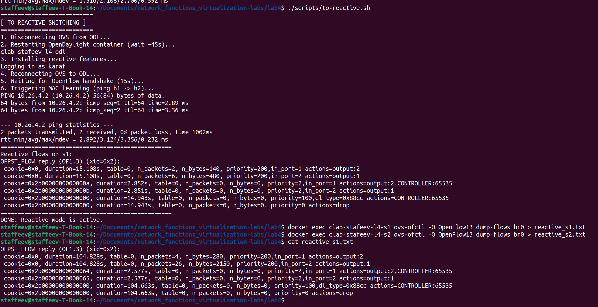

После перехода к реактивной коммутации пинг от h1 к h2 прошел успешно, а команда dump-flows показала новые правила, созданные контроллером автоматически. В сравнении с проактивной коммутацией есть следующие различия:

**Cookie.** Проактивные правила имеют `cookie=0x0` (так как это поле в JSON не указывалось), тогда как реактивные получают автоматически сгенерированные значения `cookie=0x2b00000000000000` и `0x2b00000000000001`. OpenDaylight использует их для внутренней идентификации правил, созданных приложением L2Switch.

**Приоритеты.** Проактивные правила заданы с `priority=200` для гарантированной обработки до `table-miss`. Реактивные правила, созданные L2Switch, имеют низкий приоритет `priority=2` (для выученных MAC-адресов), а также правило для LLDP с `priority=100`, `dl_type=0x88cc` и `table-miss` с `priority=0`.

**Действия.** В проактивном режиме действие - чистая пересылка `actions=output:X`. В реактивном режиме правила содержат `actions=output:X,CONTROLLER:65535`. Пакет не только пересылается на указанный порт, но и копируется контроллеру (зеркалирование). Это необходимо для того, чтобы L2Switch мог анализировать трафик, изучать MAC-адреса и динамически обновлять таблицу коммутации.

**Появление правил.** Проактивные правила создаются администратором заранее через REST API до появления трафика. Реактивные правила генерируются контроллером автоматически при поступлении первого пакета неизвестного потока.

---

# Выводы

Финальный артефакт работы продемонстрирован на рисунке 23.

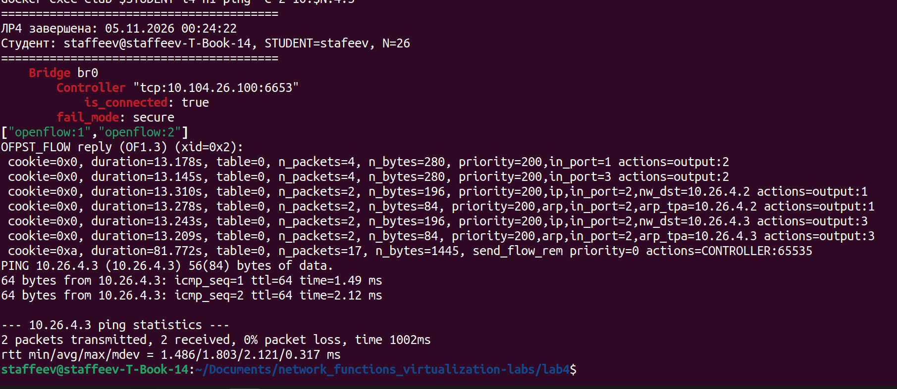

В ходе работы освоены принципы управления SDN-сетями с разделением плоскостей управления и данных. В среде Containerlab развернута топология на базе Open vSwitch и OpenDaylight, через RESTCONF API настроена проактивная пересылка трафика и реализованы ACL. Исследованы режимы отказоустойчивости (`secure` и `standalone`) и механизм восстановления правил. 

В результате получены практические навыки конфигурирования Open vSwitch, управления потоками по протоколу OpenFlow 1.3 и программирования сетевых политик через REST API. Цель работы выполнена.