University: ITMO University 
Faculty: FICT 
Course: Network Functions Virtualization 
Year: 2026/2027 
Group: K3421 
Author: Stafeev Ivan Alekseevich 
Lab: Lab5 
Date of create: 09.11.2026 
Date of finished: 11.11.2026 

# Лабораторная работа №5. Виртуализация сетевых функций (NFV) на базе MikroTik CHR и SONiC

**Цель работы:** освоить принципы виртуализации сетевых функций (NFV) на примере построения мультивендорной корпоративной сети с использованием MikroTik CHR в роли виртуального пограничного маршрутизатора (vCPE), реализующего функции NAT, межсетевого экрана и туннелирования WireGuard.

Для достижения цели были поставлены следующие задачи:

1. развернуть мультивендорную топологию в среде Containerlab, включающую коммутатор SONiC с FRR, маршрутизаторы MikroTik CHR и Linux-хосты;
2. настроить eBGP-взаимодействие между FRR (SONiC) и RouterOS 7 для обмена маршрутами между ЦОД и головным офисом;
3. реализовать функции vCPE: NAT для выхода в интернет и межсетевой экран с политикой "запрещено всё, что не разрешено";
4. организовать защищённое соединение между головным офисом и филиалом через туннель WireGuard и анонсировать сеть филиала в ЦОД;
5. управлять vCPE через REST API и обеспечить воспроизводимость конфигурации как кода (Infrastructure as Code).

---

# Подготовка образов

Для обеспечения воспроизводимости лабораторной работы (Infrastructure as Code) был использован фреймворк `vrnetlab`, который оборачивает полноценные виртуальные машины сетевых устройств в Docker-контейнеры. 

Для MikroTik CHR 7.23.8 был загружен официальный образ. Перед сборкой в `Dockerfile` были заменены зеркала Debian на архивные (`archive.debian.org`) для избежания ошибок загрузки пакетов, а также очищен кэш сборщика (рисунки 1 и 2).

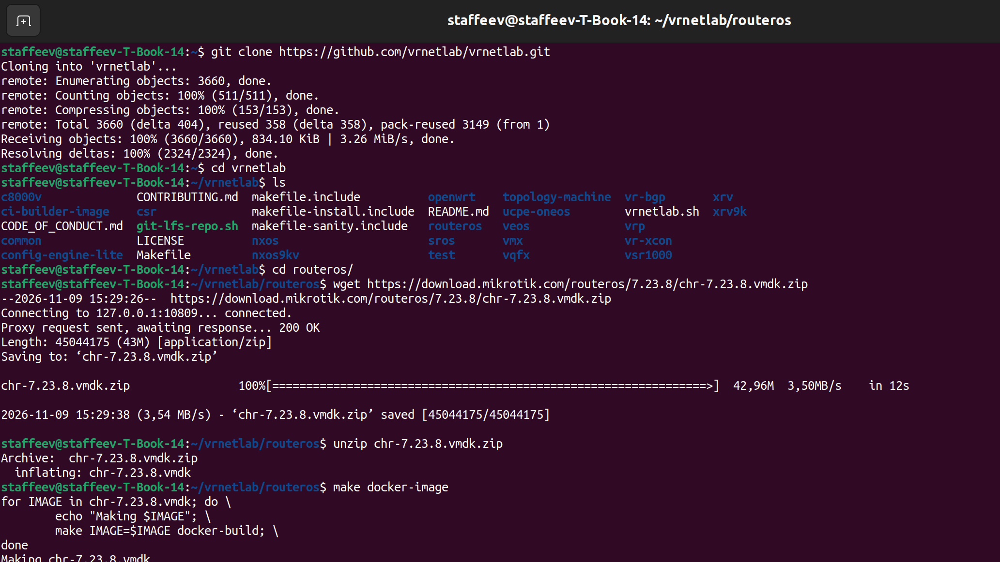

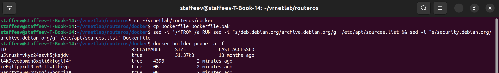

Сборка образа `vrnetlab/vr-routeros:7.23.8` прошла успешно, установив необходимые зависимости (QEMU-KVM, bridge-utils) (рисунок 3). Для узла SONiC собран кастомный образ `sonic-course:202511` с добавлением утилит `sudo`, `docker-cli` и `vtysh` для работы скриптов автоматизации (рисунок 4). Для хостов использован легковесный образ `lab-tools:1.0`.

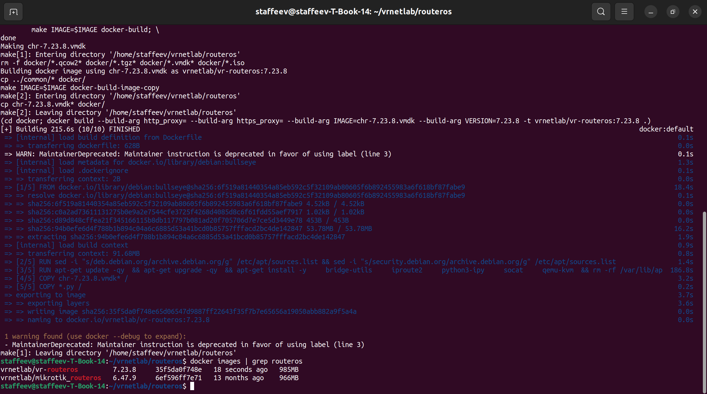

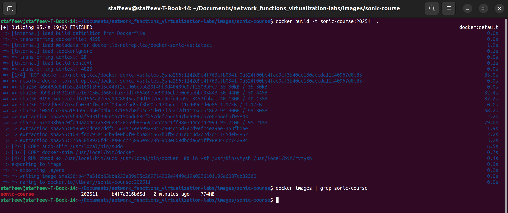

---

# Топология и доступ

Схема развернутой мультивендорной сети представлена на рисунке 5. Развертывание выполнено командой `containerlab deploy`. Узлы `hq` и `br` инициализируются дольше остальных из-за загрузки полноценной ОС внутри ВМ (рисунок 6).

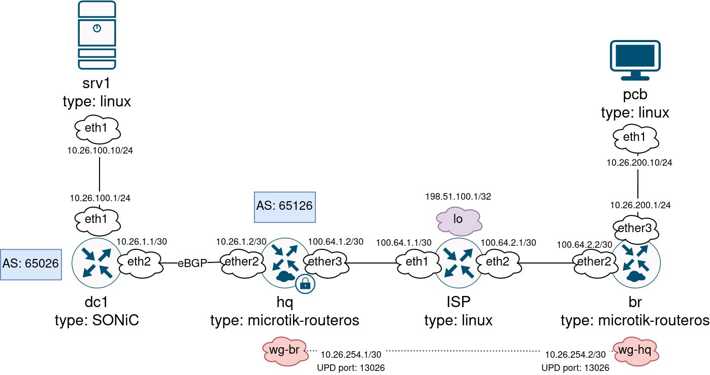

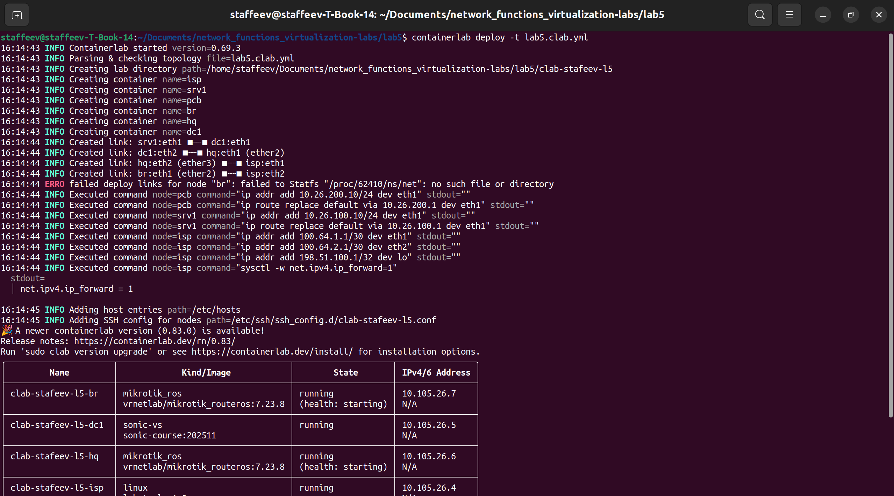

После загрузки выполнено первичное подключение по SSH. На узлах установлены имена `hq-stafeev` и `br-stafeev`, проверены системные ресурсы, лицензия и интерфейсы (рисунки 7 и 8). Вывод подтверждает, что CHR работает как ВМ на базе QEMU/KVM.

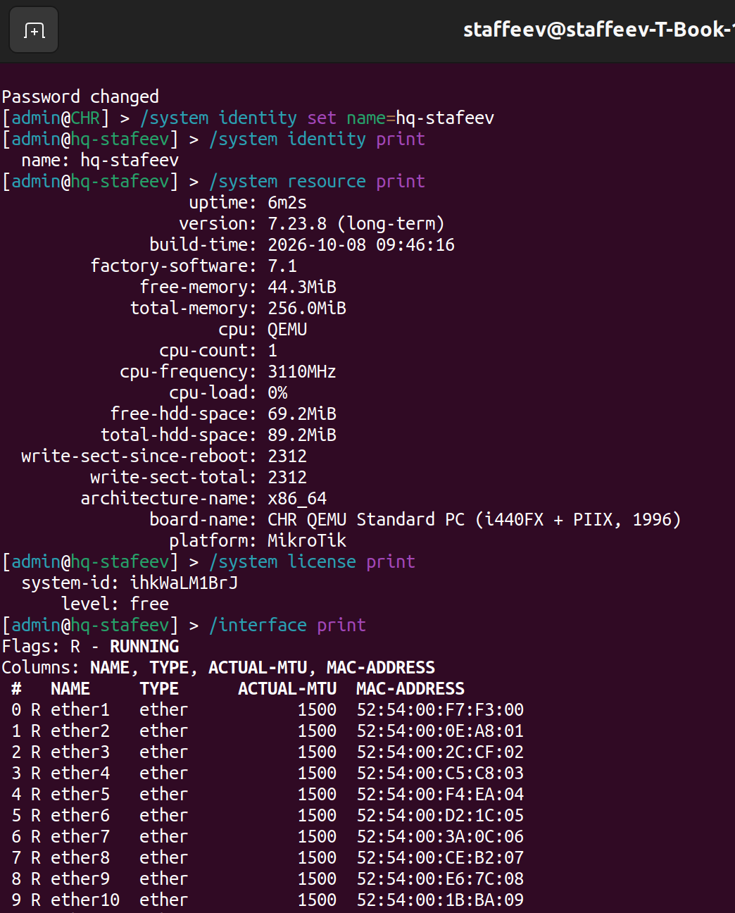

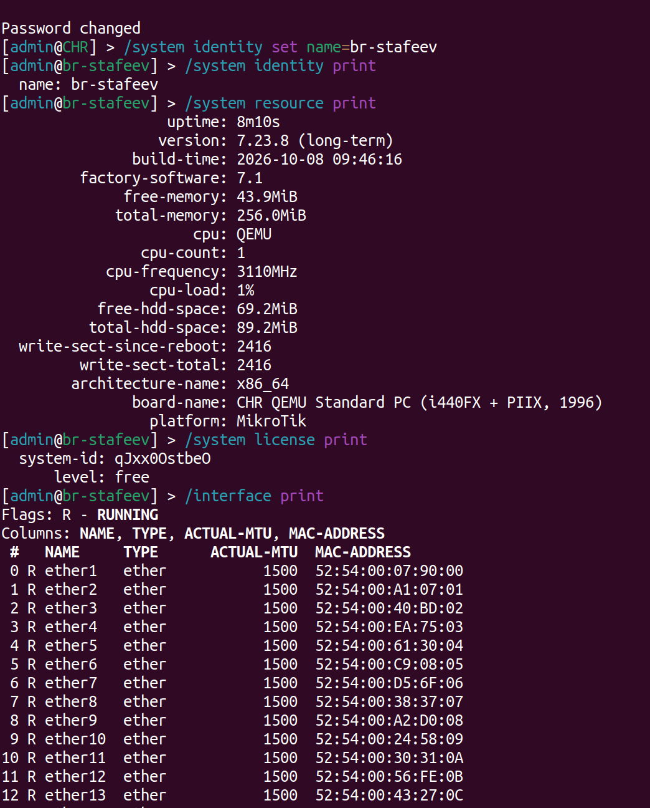

**Почему CHR требует аппаратной виртуализации, а SONiC — нет?**  
MikroTik CHR — это полноценная ОС, упакованная в образ ВМ (.vmdk), для запуска которой необходим гипервизор (QEMU/KVM), требующий поддержки флагов VMX/SVM на хосте. SONiC в данной работе использует контейнерный образ (`docker-sonic-vs`), который работает непосредственно на ядре хостовой ОС Linux через механизмы namespaces и cgroups, не эмулируя аппаратное обеспечение.

**Чем ограничена бесплатная лицензия и как это скажется на измерениях скорости?**  
Лицензия `free` ограничивает исходящую скорость каждого интерфейса CHR до 1 Мбит/с. Любые замеры пропускной способности (например, через `iperf3`) будут искусственно ограничены этим порогом, что делает невозможным тестирование реальной производительности на высоких скоростях. Для проверки связности и маршрутизации этого достаточно.

---

# Адресация

На пограничных маршрутизаторах `hq` и `br` настроена базовая IP-адресация LAN/WAN интерфейсов и статические маршруты по умолчанию через шлюзы провайдера (`100.64.1.1` и `100.64.2.1` соответственно) (рисунок 9).

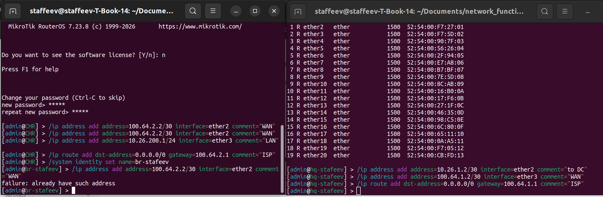

На узле SONiC `dc1` запущены демоны FRR, подняты интерфейсы `Ethernet0` (`10.26.100.1/24`) и `Ethernet4` (`10.26.1.1/30`). Проверка связности с `hq` (`10.26.1.2`) показала 0% потерь (рисунок 10).

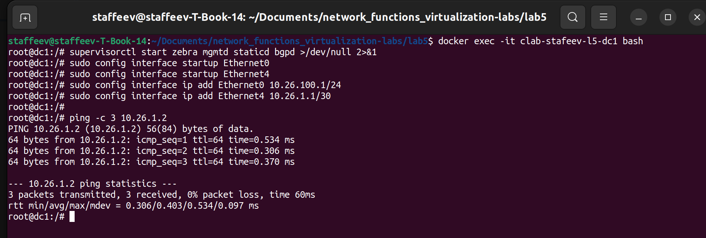

Дополнительно подтверждена корректная маршрутизация до провайдера: пинги с `hq` до `100.64.1.1` и с `br` до `100.64.2.1` проходят без потерь (рисунок 11).

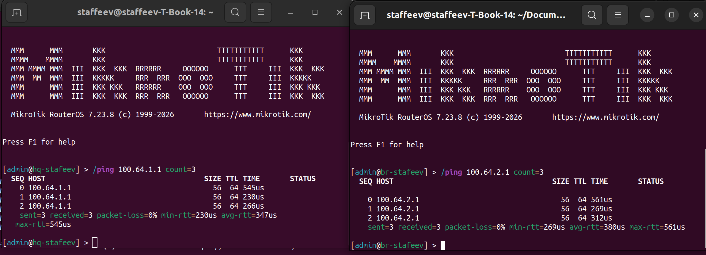

---

# eBGP между SONiC и MikroTik

Для обмена маршрутами между ЦОД и головным офисом настроен eBGP. Критически важным первым шагом на `dc1` стало удаление маршрута по умолчанию, полученного через management-интерфейс (`ip route del default dev eth0`) (рисунок 12).

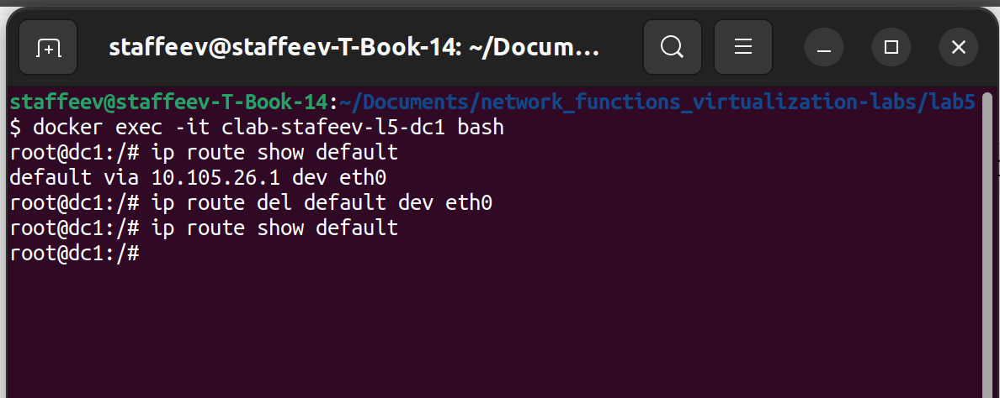

**Почему без этого шага маршрут по умолчанию, полученный по BGP, не будет использоваться?**  
Маршрутизатор выбирает путь с наименьшим административным расстоянием (AD). У статических или DHCP-маршрутов ядра (`K`) AD равно 0 или 1. У маршрутов eBGP (`B`) AD равно 20. Если не удалить management-маршрут, трафик будет идти через него, игнорируя корректный BGP-путь через `hq`.

Далее на `dc1` через `vtysh` применена конфигурация FRR: задан AS 65026, сосед `10.26.1.2` (AS 65126) и анонсирована сеть `10.26.100.0/24` (рисунок 13). На `hq` создан BGP-инстанс и соединение с параметром `output.default-originate=if-installed` (рисунок 14).

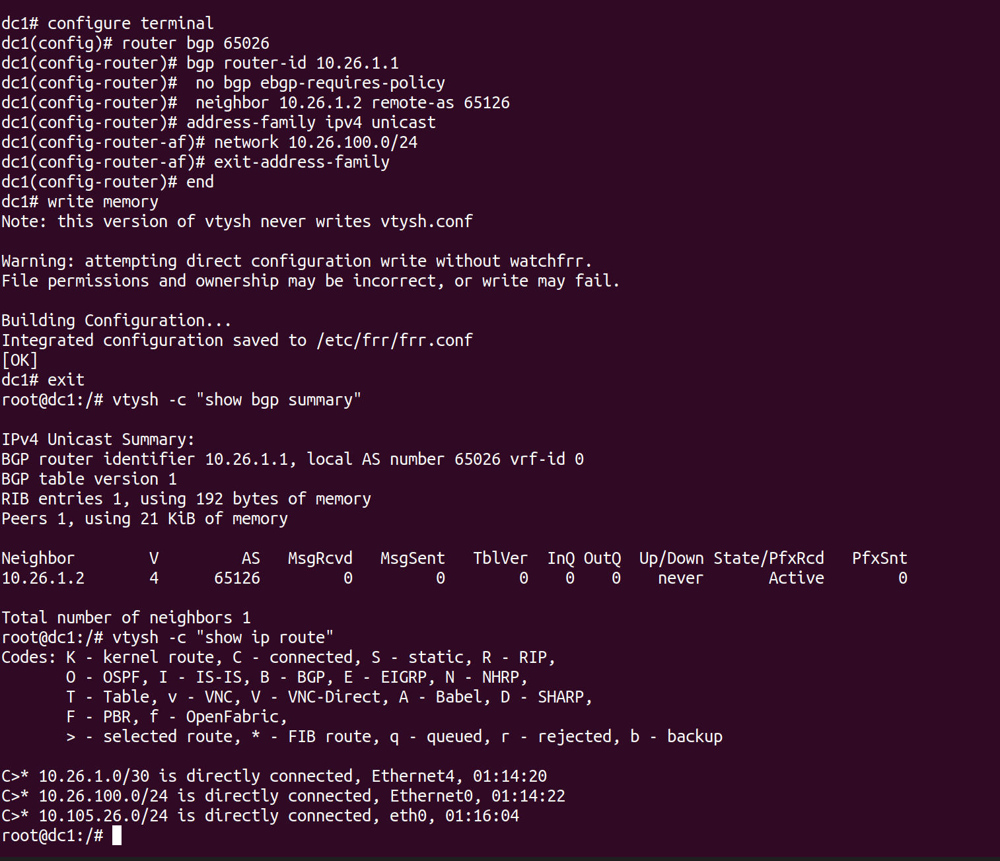

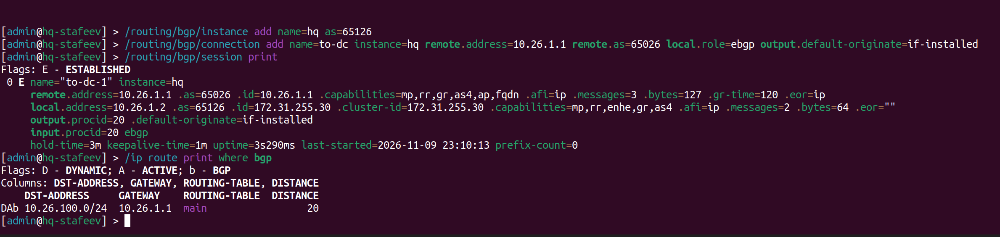

**Почему `output.default-originate=if-installed` надёжнее, чем `always`?**  
Параметр `if-installed` предписывает анонсировать маршрут `0.0.0.0/0` только если он реально присутствует в таблице маршрутизации `hq`. При обрыве канала до провайдера этот маршрут исчезнет, и анонс прекратится. Режим `always` продолжил бы анонсировать маршрут, создав «чёрную дыру» (black hole), так как `dc1` отправлял бы трафик в никуда.

Итоговая проверка на `dc1` подтверждает успешное соседство (статус `Estab`) и появление активного BGP-маршрута `B>* 0.0.0.0/0 [20/0] via 10.26.1.2` (рисунок 15).

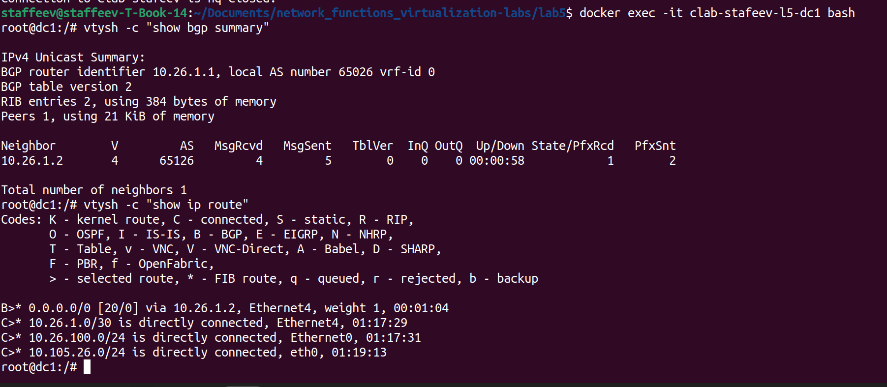

---

# vCPE: NAT и межсетевой экран

На маршрутизаторе `hq` настроен NAT для выхода в интернет: добавлено правило `masquerade` в цепочке `srcnat` для интерфейса `ether3` (WAN). Проверка показала успешный доступ из ЦОД к интернет-ресурсу: HTTP-запрос к `198.51.100.1` вернул код 200. Логи провайдера подтверждают, что запросы приходят с адреса `100.64.1.2` (внешний адрес `hq`), а не с внутреннего `10.26.100.10` (рисунок 16).

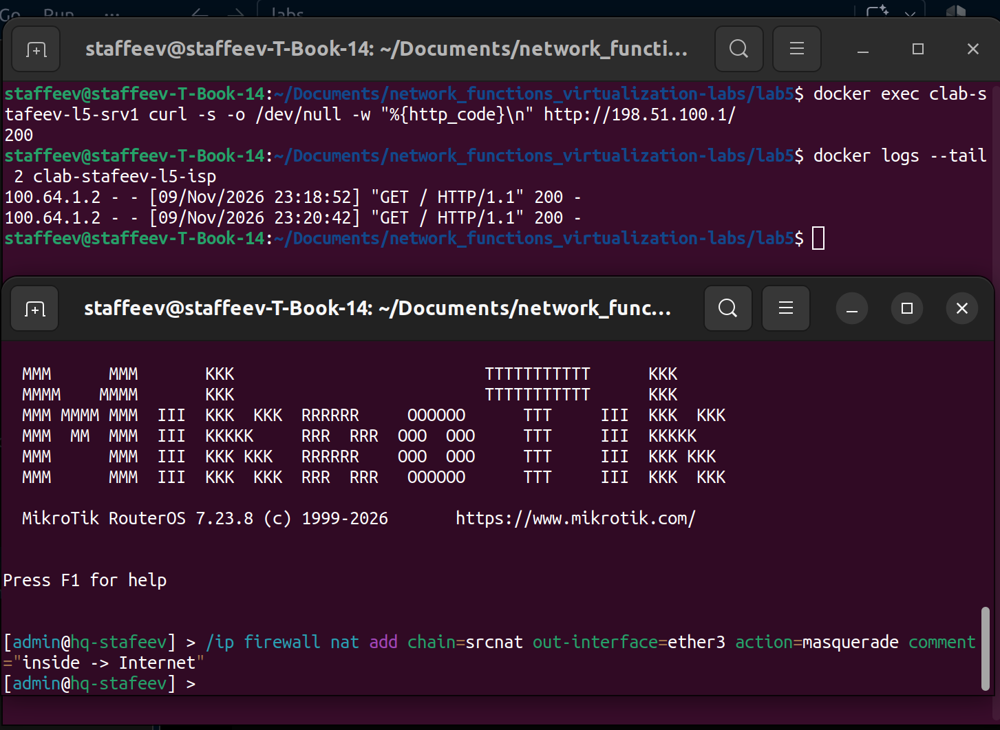

Реализована политика межсетевого экрана "запрещено всё, что не разрешено". На `hq` добавлены правила фильтрации:
- `input`: разрешение established/related, ICMP, management-трафика (ether1), BGP (ether2, порт 179); запрет остального трафика с WAN (ether3);
- `forward`: разрешение established/related и трафика из ЦОД в интернет (ether2 -> ether3); запрет всего остального (default deny) (рисунок 17).

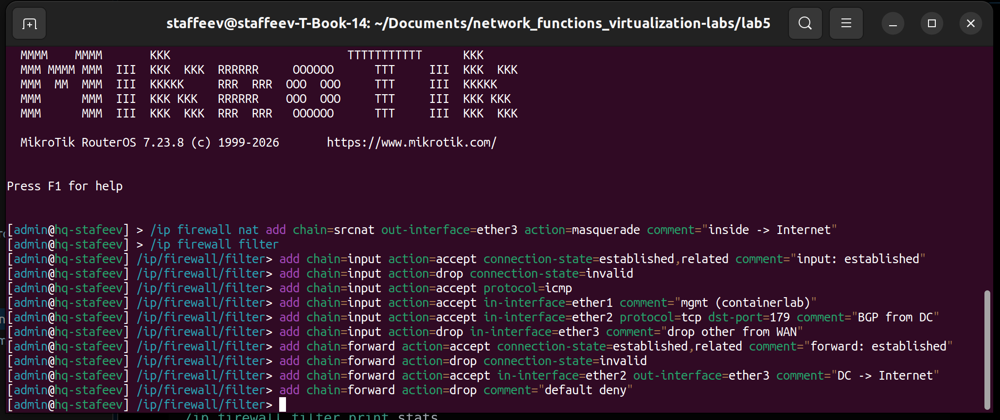

Проверка политики: HTTP-запрос из ЦОД проходит успешно (код 200), тогда как ping от провайдера к серверу ЦОД (`10.26.100.10`) блокируется (100% потерь). Статистика фаервола показывает, что правило `default deny` отбросило пакеты (рисунок 18).

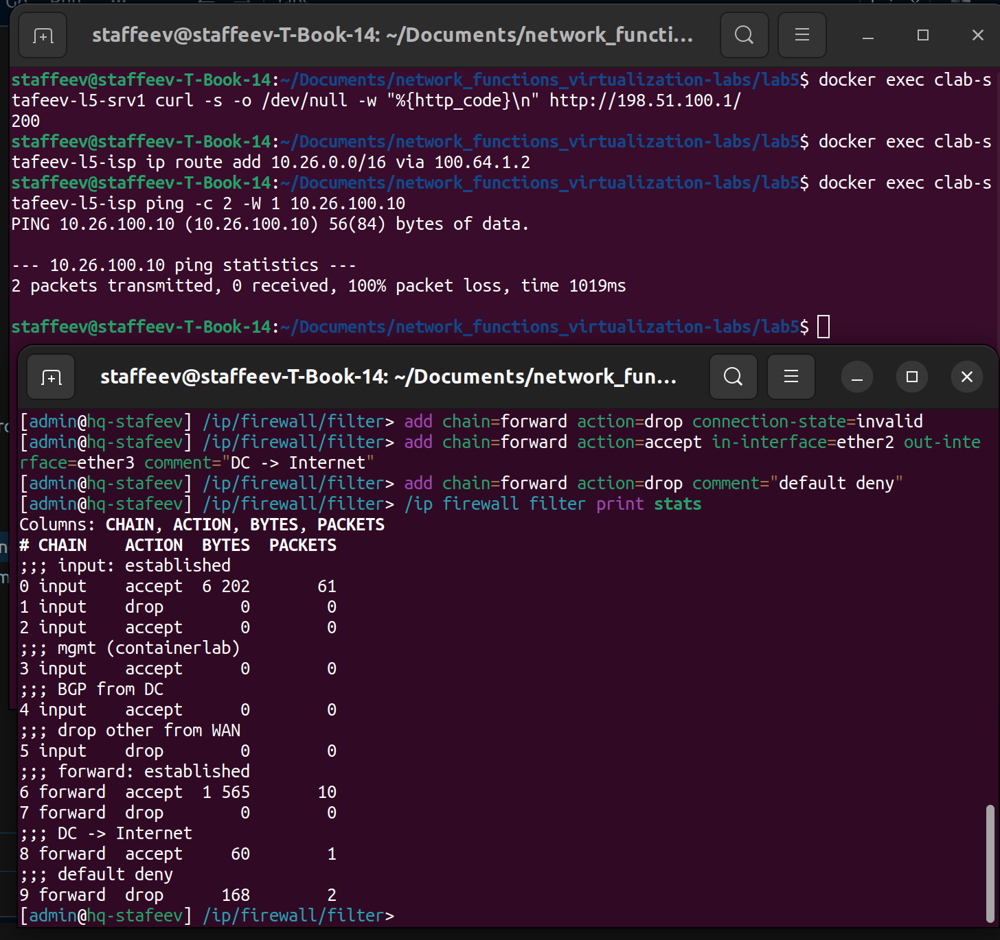

**Почему ответы `198.51.100.1 -> srv1` проходят, хотя явного разрешающего правила для направления `ether3 -> ether2` нет?**  
Правило `chain=forward action=accept connection-state=established,related` разрешает весь обратный трафик, который является частью уже установленных соединений. Когда `srv1` инициирует соединение с интернетом (исходящий трафик `ether2 -> ether3`), фаервол запоминает это соединение в таблице состояний (state table). Ответный трафик от `198.51.100.1` помечается как `established` или `related`, и первое правило в chain `forward` его пропускает. Это стандартное поведение stateful firewall — нет необходимости явно разрешать каждый обратный поток.

---

# Филиал через WireGuard

Для организации защищённого соединения между головным офисом и филиалом настроен туннель WireGuard. На обоих узлах (`hq` и `br`) создан интерфейс `wg` с портом прослушивания `13026`, сгенерированы пары ключей. На `hq` добавлен пир с публичным ключом `br`, разрешёнными адресами `10.26.254.2/32` и `10.26.200.0/24` (сеть филиала). На `br` настроен пир с ключом `hq` и разрешёнными адресами `10.26.254.1/32` и `10.26.100.0/24` (сеть ЦОД) (рисунок 19).

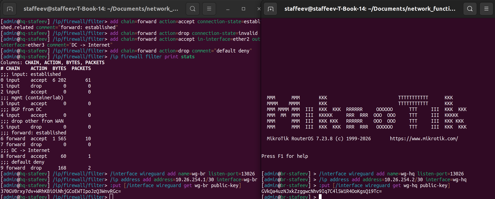

Добавлены статические маршруты: на `hq` сеть филиала `10.26.200.0/24` направлена через `wg-br`, на `br` сеть ЦОД `10.26.100.0/24` — через `wg-hq`. В межсетевой экран `hq` добавлены правила: разрешение UDP-порта 13026 для WireGuard (перед правилом `drop other from WAN`) и разрешение forward-трафика между `wg-br` и `ether2`. Сеть филиала `10.26.200.0/24` добавлена в address-list `to-dc` и анонсирована в BGP (рисунок 20).

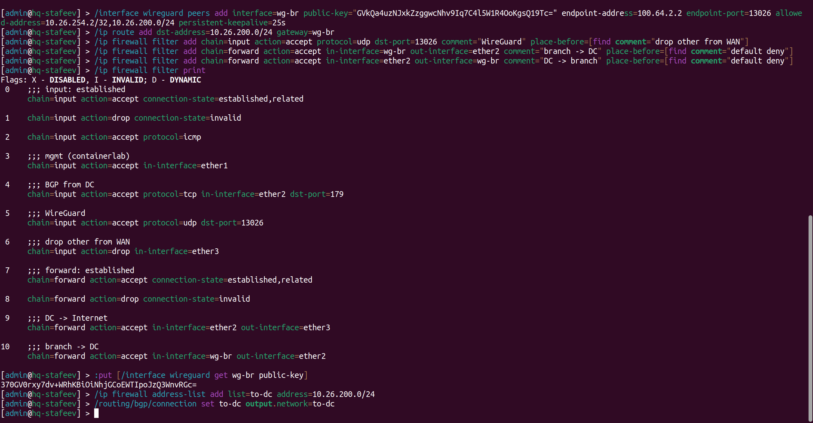

На `br` настроен NAT (`masquerade`) для выхода в интернет через WAN-интерфейс `ether2` (рисунок 21).

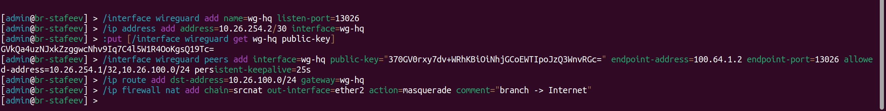

Проверка показала успешную работу туннеля: на `dc1` появился BGP-маршрут до `10.26.200.0/24` через `10.26.1.2`. Ping с рабочей станции филиала (`pcb`, `10.26.200.10`) до сервера ЦОД (`srv1`, `10.26.100.10`) прошёл без потерь. Анализ трафика на узле провайдера (`tcpdump` на `eth2`) показал только UDP-пакеты между `100.64.1.2` и `100.64.2.2` на порт `13026`. Статус пиров WireGuard на обоих концах — `last-handshake` активен, счётчики `rx/tx` увеличиваются (рисунок 22).

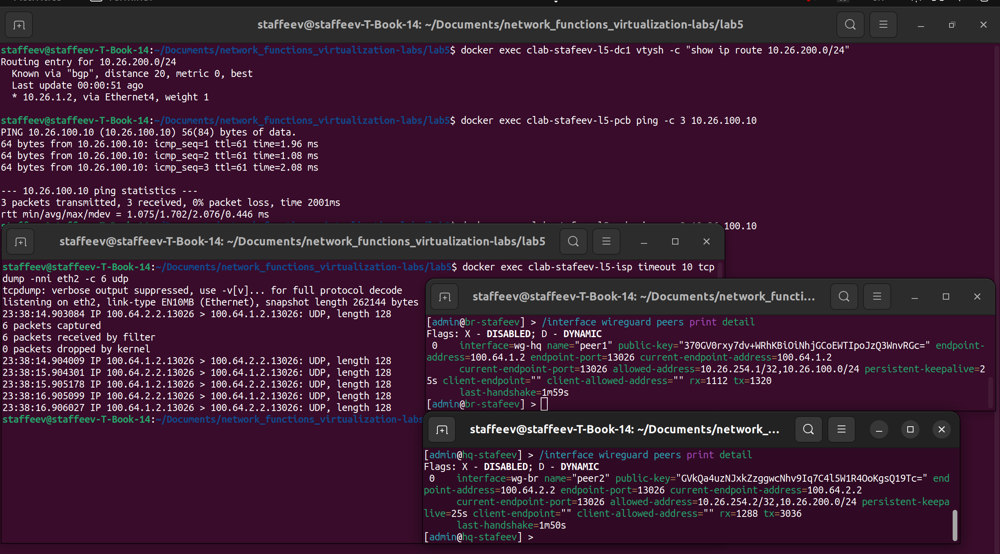

**Какие адреса и порты видит провайдер? Видны ли ему адреса `10.N.x.x`?**  
Провайдер видит только внешние IP-адреса WAN-интерфейсов: `100.64.1.2` (`hq`) и `100.64.2.2` (`br`), а также UDP-порт `13026`, используемый WireGuard для инкапсуляции трафика. Внутренние адреса сети предприятия (`10.26.x.x`) не видны провайдеру, так как весь трафик между `hq` и `br` инкапсулируется в зашифрованный туннель WireGuard. В выводе `tcpdump` отсутствуют какие-либо упоминания о `10.26.x.x` — только зашифрованные UDP-пакеты между публичными адресами.

---

# Работа через REST API и конфигурация как код

Для управления маршрутизатором `hq` через REST API был включён встроенный веб-сервер RouterOS командой `/ip service set www disabled=no`. Разработан отдельный скрипт `rest-demo.sh`, автоматизирующий выполнение CRUD-операций: GET-запросы для чтения состояния (`/system/identity`, `/ip/address`, `/routing/bgp/session`), PUT для создания записи в address-list, PATCH для её изменения и DELETE для удаления. Скрипт выводит результаты в формате JSON, что удобно для интеграции с системами автоматизации (рисунок 23).

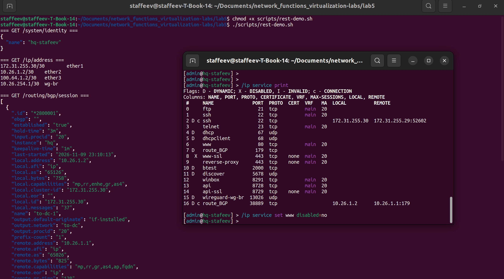

Для фиксации состояния сети в системе контроля версий выполнена выгрузка конфигураций всех узлов. С MikroTik конфигурация экспортирована командой `/export terse` через SSH, с SONiC — командой `vtysh -c "show running-config"`. Полученные файлы (`hq.rsc`, `br.rsc`, `dc1-frr.conf`) сохранены в каталоге `configs/` (рисунок 24).

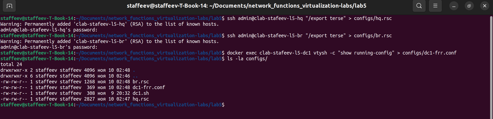

**Почему в экспорт по умолчанию не попадает приватный ключ WireGuard?**  
Команда `/export terse` экспортирует только конфигурационные параметры, не содержащие чувствительных данных (пароли, ключи, сертификаты). Приватный ключ WireGuard является секретом и по умолчанию исключается из экспорта для предотвращения случайной утечки. Для его выгрузки требуется явное указание флага `show-sensitive`, что создаёт риск попадания секрета в открытый доступ.

**Как правильно хранить такие секреты в репозитории?**  
Приватные ключи и пароли никогда не должны храниться в Git-репозитории в открытом виде. Корректные подходы:
- Использование менеджеров секретов (HashiCorp Vault, AWS Secrets Manager, Kubernetes Secrets);
- Хранение секретов в переменных окружения CI/CD-пайплайна с инъекцией при деплое;
- Применение placeholder'ов в конфигурационных файлах (например, `$WG_PRIVATE_KEY`), которые заполняются из защищённого хранилища при развёртывании;
- Добавление файлов с секретами в `.gitignore` для исключения из коммита;
- Генерация ключей автоматически при старте устройства (как реализовано в скрипте `deploy.sh` для обеспечения воспроизводимости).

---

# Воспроизводимость лабораторной работы

Для обеспечения полной воспроизводимости лабораторной работы реализован подход Infrastructure as Code. Конфигурация сети описана декларативно в файле `lab5.clab.yml`, где для узлов MikroTik CHR задан параметр `startup-config`, автоматически применяющий конфигурацию при загрузке, а для узла SONiC `dc1` через механизм `binds` и `exec` монтируется и выполняется скрипт `apply.sh`, настраивающий интерфейсы, удаляющий management-маршрут и загружающий конфигурацию BGP в FRR.

Разработан оркестратор `deploy.sh`, автоматизирующий полный цикл развёртывания: уничтожение предыдущей топологии, деплой, ожидание загрузки узлов, динамическую настройку WireGuard с извлечением свежих публичных ключей, ожидание установления BGP-сессии, проверку связности и запуск REST API тестов (рисунок 25).

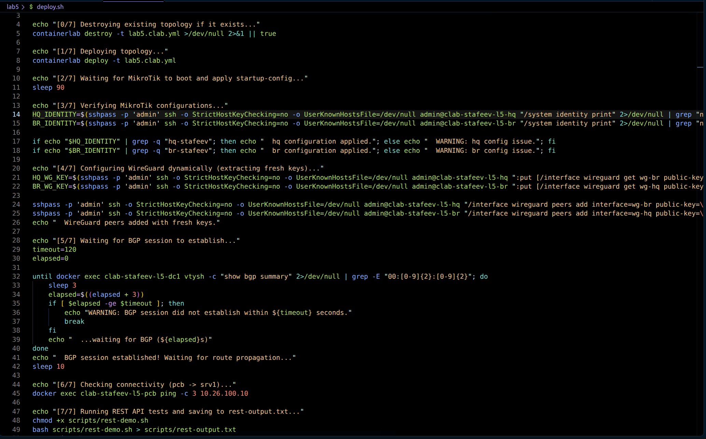

Ключевой особенностью является динамическая настройка WireGuard: поскольку эмулятор `vrnetlab` при каждом старте генерирует новую пару ключей для интерфейсов MikroTik, скрипт считывает актуальные публичные ключи через SSH и добавляет пиры с корректными значениями, что обеспечивает успешный handshake туннеля.

Результат выполнения скрипта показан на рисунке 26: топология развёрнута, конфигурации применены, BGP-сессия установлена, пинг между филиалом и ЦОД проходит без потерь, REST API тесты выполнены успешно.

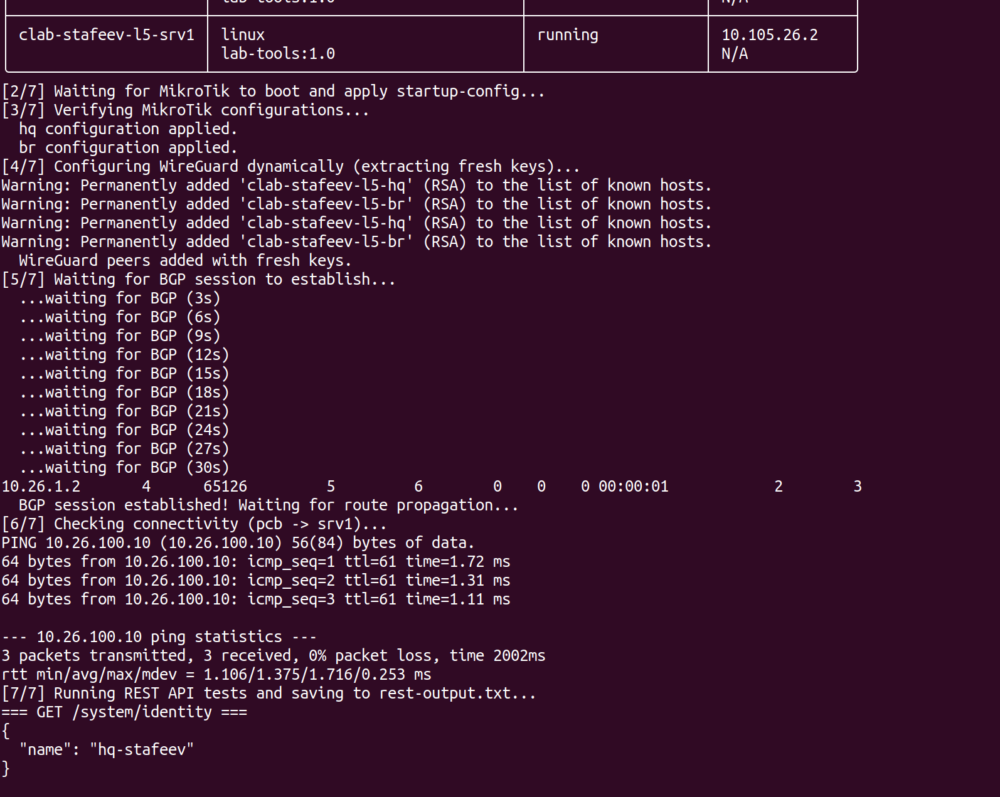

Такой подход гарантирует, что лабораторная работа может быть воспроизведена с нуля одной командой `./deploy.sh` на любой системе с установленными Docker и Containerlab, без необходимости ручного ввода конфигураций.

---

# Выводы

Финальный артефакт работы продемонстрирован на рисунке 27.

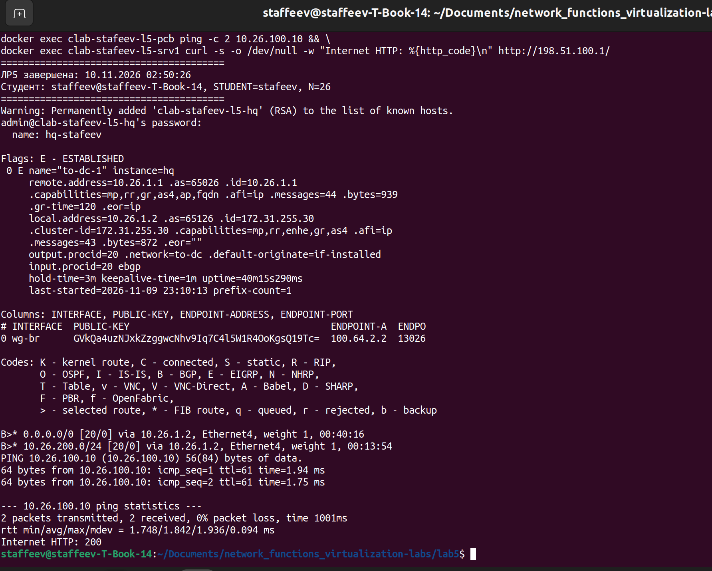

В ходе работы освоены принципы виртуализации сетевых функций (NFV) на примере построения мультивендорной корпоративной сети. В среде Containerlab развёрнута топология на базе MikroTik CHR (vCPE) и SONiC с FRR, настроено eBGP-взаимодействие между ЦОД и головным офисом, реализованы функции NAT и stateful межсетевого экрана. Организован защищённый туннель WireGuard между головным офисом и филиалом с анонсированием сети филиала в ЦОД через BGP. Управление маршрутизатором осуществлено через REST API, обеспечена полная воспроизводимость конфигурации как кода (Infrastructure as Code).

В результате получены практические навыки развёртывания виртуальных сетевых функций, настройки протокола BGP между разнородными платформами, туннелирования WireGuard, программирования сетевых политик через REST API и автоматизации развёртывания через скрипты-оркестраторы. Цель работы выполнена.