University: ITMO University<br />
Faculty: FICT<br />
Course: Network Functions Virtualization<br />
Year: 2026/2027<br />
Group: K3421<br />
Author: Stafeev Ivan Alekseevich<br />
Lab: Lab6<br />
Date of create: 12.11.2026<br />
Date of finished: 12.11.2026<br />

# Лабораторная работа №6. Цепочка сервисных функций (SFC) и жизненный цикл VNF под управлением SDN

**Цель работы:** освоить принципы виртуализации сетевых функций (NFV) и управления жизненным циклом VNF в рамках архитектуры ETSI NFV MANO на примере построения цепочки сервисных функций (SFC), в которой трафик клиентов проходит через межсетевой экран и шейпер под управлением SDN-контроллера OpenDaylight.

Для достижения цели были поставлены следующие задачи:
1. развернуть инфраструктуру NFVI (OVS и контейнеры) под управлением OpenDaylight по протоколу OpenFlow 1.3;
2. описать VNF дескрипторами (VNFD) и выполнить операции instantiate и configure через скрипт-аналог VNFM;
3. построить сервисную цепочку по описанию VNFFG и запрограммировать маршрутизацию через NFVO;
4. проверить работу функций цепочки: блокировку порта FW и ограничение скорости шейпером;
5. выполнить scale-out с созданием второго экземпляра FW и heal с переключением цепочки на резервный экземпляр;
6. оценить производительность цепочки и рассмотреть технологии NFV Acceleration.

---

# 1. NFVI и контроллер

Схема развернутой инфраструктуры NFVI представлена на рисунке 1. Топология включает коммутатор OVS, SDN-контроллер OpenDaylight, два клиента, сервер и две VNF: межсетевой экран `fw1` и шейпер `shaper1`. VNF подключены к коммутатору «в разрыв» (bump-in-the-wire). Порты `eth5`/`eth6` оставлены свободными для последующего scale-out.

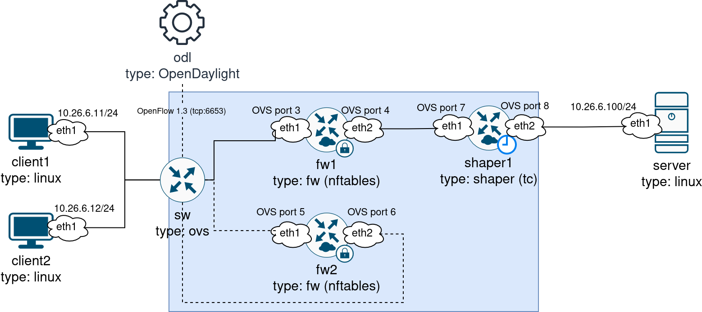

Развертывание выполнено командой `containerlab deploy -t lab6.clab.yml` с переменными `STUDENT=stafeev` и `N=26`. Все узлы созданы в состоянии `running`, management-подсеть `10.106.26.0/24` сформирована автоматически. На `client1`, `client2` и `server` отключён TX offload командой `ethtool -K eth1 tx off` и назначены адреса подсети данных (рисунок 2).

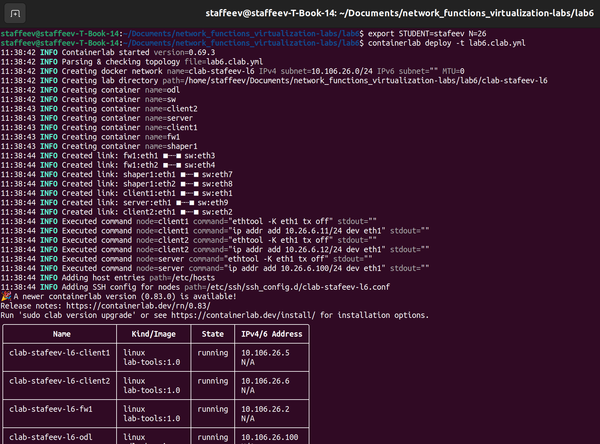

На сервере запущены `iperf3 -s` для измерения пропускной способности и `python3 -m http.server 8026` для проверки блокировки персонального порта межсетевого экрана. Команды `ps aux` и `ss -tuln` подтвердили работу обоих сервисов на портах `5201` и `8026` (рисунок 3).

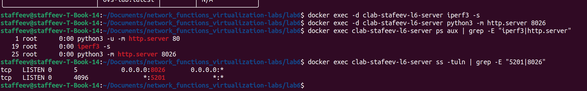

Для подключения OVS к контроллеру через Karaf-CLI установлены плагины `odl-openflowplugin-flow-services-rest` и `odl-openflowplugin-app-table-miss-enforcer`. Скрипт `sw-setup.sh` создал мост `br0` с параметрами `datapath_type=netdev`, `protocols=OpenFlow13`, `fail-mode=secure` и добавил интерфейсы `eth1`–`eth9` с фиксированными номерами OpenFlow-портов. Команда `ovs-vsctl show` подтвердила подключение к контроллеру `tcp:10.106.26.100:6653` (`is_connected: true`) (рисунок 4).

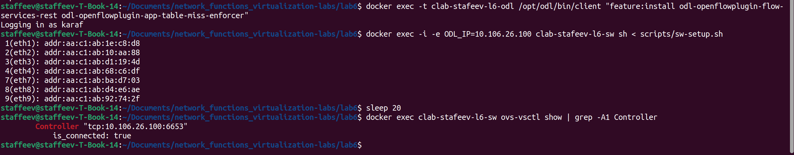

До применения конфигурации цепочки выполнена проверка связности между `client1` и `server`. Ping показал 100% потерь (рисунок 5), что соответствует режиму работы OVS до программирования потоков.

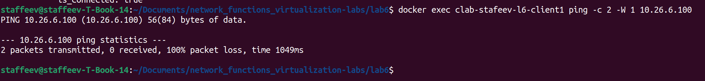

**Почему ping от `client1` до `server` не проходит, хотя они находятся в одной подсети?**

OVS настроен с параметром `fail-mode=secure`: при отсутствии правил OpenFlow входящие пакеты отбрасываются. До применения VNFFG через `nfvo.py` потоки не запрограммированы, поэтому трафик между `client1` (`10.26.6.11`) и `server` (`10.26.6.100`) не передаётся. Таким образом, путь трафика определяется не только IP-адресацией, но и потоками OpenFlow, программируемыми SDN-контроллером.

---

# 2. Onboarding и instantiate VNF

Описание VNF выполнено дескрипторами в формате, упрощённом по мотивам ETSI SOL001/TOSCA. Для межсетевого экрана использован `descriptors/fw-vnfd.yaml`, для шейпера создан `descriptors/shaper-vnfd.yaml`. В обоих дескрипторах поле `provider` заполнено как `stafeev`, а образ VDU указан как `lab-tools:1.0`.

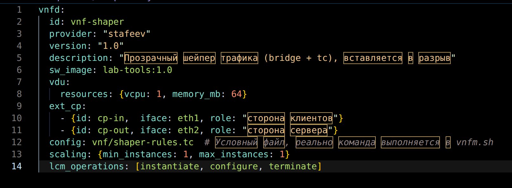

Настройка экземпляров VNF выполнена скриптом-аналогом VNFM:
`./vnfm.sh configure fw1 fw` и
`./vnfm.sh configure shaper1 shaper`.
Скрипт создал внутри каждого контейнера мост `br0`, перевёл в него интерфейсы `eth1` и `eth2`, отключил аппаратный offload и применил day-1 конфигурацию. Для `fw1` настроены правила nftables с блокировкой TCP-порта `8026`, для `shaper1` - дисциплина `tbf` со скоростью `16 Mbit` (рисунок 7).

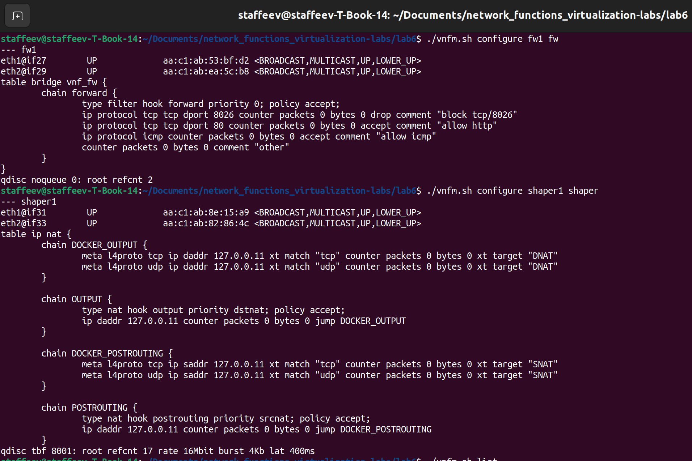

Команда `./vnfm.sh list` показала все экземпляры в состоянии `Up`. В конфигурации FW присутствует правило `tcp dport 8026 ... drop` с комментарием `block tcp/8026`, а шейпер настроен через `qdisc tbf` со скоростью `16Mbit`, burst `4Kb` и задержкой `400ms` (рисунок 8). Значения `8026` и `16 Mbit` получены из персональных параметров:
$8000 + N = 8026$ и $10 + (N \bmod 10) = 16$.

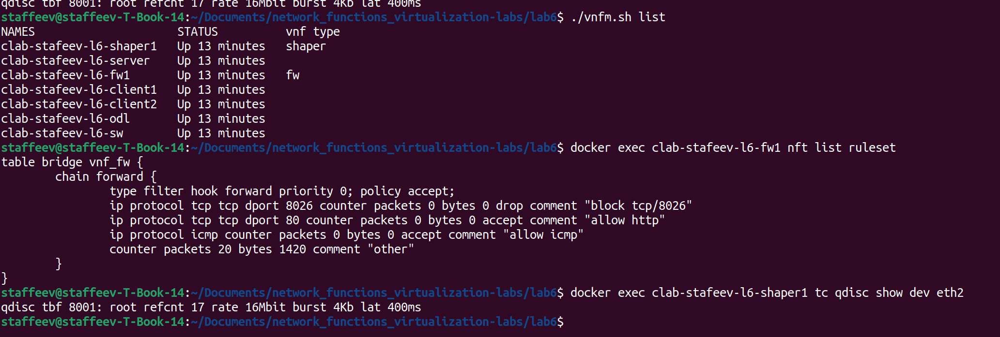

**Какие поля VNFD соответствуют сущностям ETSI SOL001 и чего не хватает до полноценного дескриптора?**

Поле `vdu` соответствует Virtual Deployment Unit и содержит вычислительные ресурсы и образ, `ext_cp` - Connection Point, `scaling` - Scaling Aspect, `lcm_operations` - операции жизненного цикла, `config` - day-1 конфигурацию, `sw_image` - образ VDU.

До полноценного дескриптора SOL001 не хватает описания образов с контрольными суммами (checksum), требований к мониторингу и метрик для алертов, политик размещения (affinity/anti-affinity и placement constraints), сетевых требований и day-2 конфигурации, позволяющей изменять правила без пересоздания экземпляра.

---

# 3. Сервисная цепочка

Описание цепочки задано в файле `vnffg.yaml`. Раздел `chains` содержит логические пути от клиента к серверу через VNF, а `endpoints` - IP-адреса и номера портов конечных точек. Для `stafeev-c1` и `stafeev-c2` задан путь `[fw1, shaper1]`.

При первом запуске `python3 nfvo.py apply vnffg.yaml` возникла ошибка `simplejson.errors.JSONDecodeError`. OpenDaylight по умолчанию возвращал XML, тогда как скрипт ожидал JSON. Проблема решена добавлением заголовка `Accept: application/json` в HTTP-запросы класса `Odl` и обработкой пустого тела ответа. После исправления команда завершилась успешно: `applied: 24 flows, removed stale: 0` (рисунок 9).

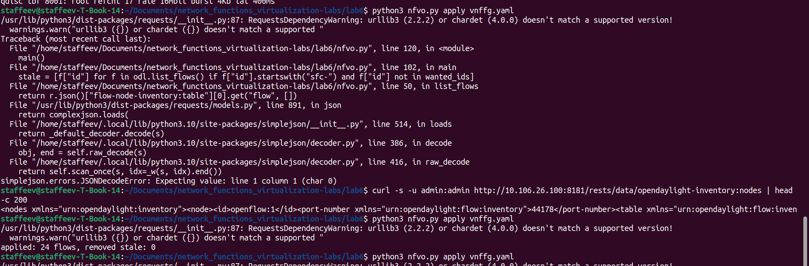

Команда `ovs-ofctl dump-flows` подтвердила наличие 24 потоков с приоритетом 300. Каждый переход цепочки реализован двумя потоками: для IPv4 (`ethernet-type 2048`) и ARP (`ethernet-type 2054`). В прямом направлении используется матч по входному порту и IP-адресу источника, в обратном - по входному порту и адресу назначения. Действие потоков - `output` на следующий порт (рисунок 10).

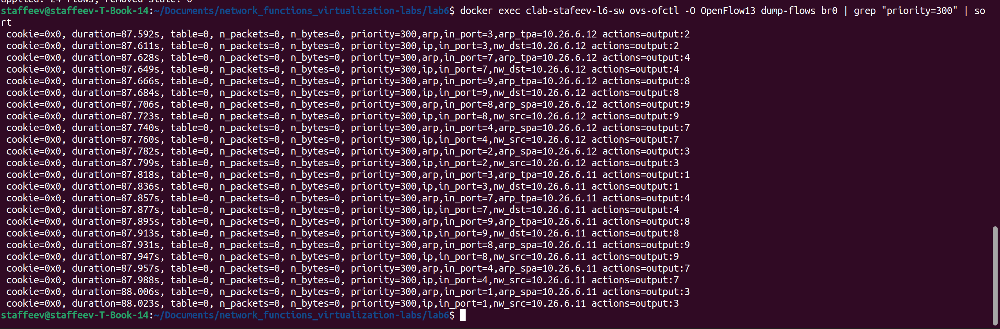

**Почему на каждый переход цепочки нужно два потока (IPv4 и ARP)?**

VNF реализованы как прозрачные мосты (bump-in-the-wire) и не имеют IP-адресов. Для передачи IP-пакета требуется MAC-адрес получателя, который определяется через ARP. Если запрограммировать только IPv4-поток, ARP-запрос от `client1` не пройдёт через цепочку, и клиент не сможет разрешить MAC-адрес сервера. Поэтому для каждого перехода создаётся отдельный поток для IPv4 (`ethernet-type 2048`) и ARP (`ethernet-type 2054`).

**Почему обратное направление матчится по адресу получателя (`ipv4-destination`)?**

В ответном пакете сервера IP-адрес клиента находится в поле назначения. Например, для `client1` это `10.26.6.11`. Поэтому `nfvo.py` формирует обратный поток с матчем `ipv4-destination=10.26.6.11`, направляя трафик через `shaper1` → `fw1` → `client1`. Это обеспечивает симметричный путь, необходимый для stateful-функций.

Таблица потоков для цепочки `stafeev-c1` (`client1` → `server`):

| Направление | in_port | out_port | Match |
|---|---|---|---|
| fwd0 (client1 → fw1) | 1 | 3 | src=10.26.6.11 |
| fwd1 (fw1 → shaper1) | 4 | 7 | src=10.26.6.11 |
| fwd2 (shaper1 → server) | 8 | 9 | src=10.26.6.11 |
| rev0 (server → shaper1) | 9 | 8 | dst=10.26.6.11 |
| rev1 (shaper1 → fw1) | 7 | 4 | dst=10.26.6.11 |
| rev2 (fw1 → client1) | 3 | 1 | dst=10.26.6.11 |

После программирования цепочки ping от `client1` до `server` проходит с 0% потерь, HTTP-запрос на порт 80 возвращает код 200, а запрос к порту 8026 - код 000, поскольку соединение разрывается FW. Счётчики nftables подтверждают блокировку: правило `block tcp/8026` отбросило 3 пакета.

Измерение `iperf3` в прямом направлении показало снижение скорости до ~2 Мбит/с с обрывом control-сокета, в обратном направлении - 830 Мбит/с без ограничений (рисунок 11).

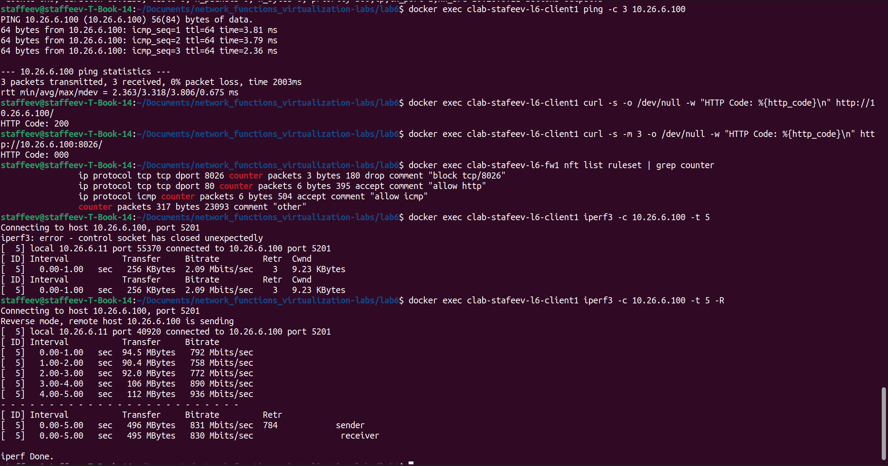

Команда `python3 nfvo.py show vnffg.yaml` выводит статистику потоков из operational-хранилища ODL. Для `stafeev-c1` все потоки имеют ненулевые счётчики, например `fwd0-ip: pkts=12335` и `rev0-ip: pkts=55548`, что подтверждает прохождение трафика через цепочку. Для `stafeev-c2` счётчики равны нулю, поскольку трафик генерировался только от `client1` (рисунок 12).

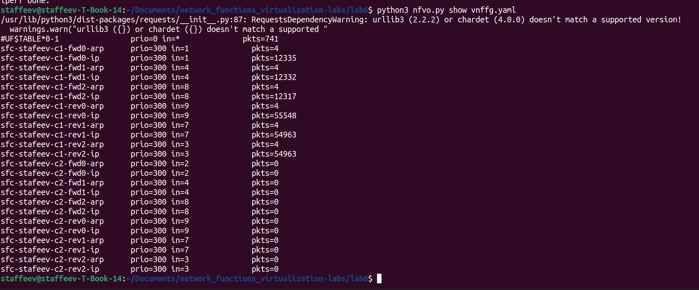

**Что изменится, если сделать FW stateful (`ct state`), и почему прямой и обратный трафик обязаны идти через один и тот же экземпляр FW?**

Stateful межсетевой экран хранит таблицу состояний соединений (conntrack). При прохождении TCP SYN через `fw1` запись о сессии создаётся в памяти этого экземпляра. Если ответный TCP ACK попадёт на `fw2`, тот не найдёт соответствующего состояния и может отбросить пакет как `invalid`. Поэтому прямой и обратный трафик одного соединения должны проходить через один экземпляр FW.

В данной работе FW реализован как stateless, без `ct state`, поэтому симметричность не является обязательной, но сохраняется для единообразия цепочки.

---

# 4. Scale-out: второй экземпляр FW

Для демонстрации горизонтального масштабирования создан второй экземпляр межсетевого экрана `fw2`. Его развёртывание выполняется командой `./vnfm.sh instantiate fw2 fw 5 6`

Скрипт создаёт Docker-контейнер из образа `lab-tools:1.0`, формирует veth-пары между контейнером и OVS и применяет day-1 конфигурацию. Создаются пары `fw2:eth1`-`sw:eth5` и `fw2:eth2`-`sw:eth6`, после чего порты `eth5`/`eth6` добавляются в `br0`. В контейнере создаётся мост `br0`, интерфейсы `eth1`/`eth2` подключаются к нему, отключается аппаратный offload и применяются правила `fw-rules.nft`: блокировка `8026`, разрешение HTTP и ICMP. Команда `ovs-ofctl show br0` подтверждает появление портов `5(eth5)` и `6(eth6)` (рисунок 13).

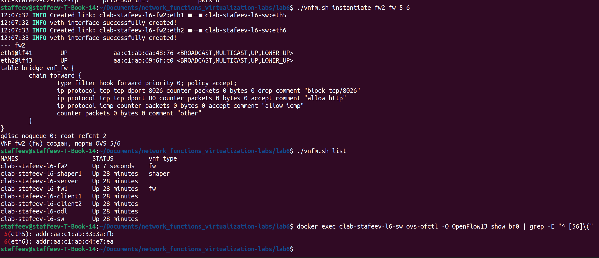

Для переноса трафика `client2` изменён `vnffg.yaml`: путь `stafeev-c2` заменён с `[fw1, shaper1]` на `[fw2, shaper1]`. Команда `python3 nfvo.py apply vnffg.yaml` завершилась с результатом `applied: 24 flows, removed stale: 0`.

Нулевое значение `removed stale` связано с идентификаторами потоков: `sfc-stafeev-c2-fwd0-ip` и аналогичные ID зависят от имени цепочки и номера шага, но не от портов. Метод `PUT` в OpenDaylight работает как upsert, поэтому существующие правила с теми же ID были перезаписаны новыми портами.

Проверка показала корректный перенос: HTTP от `client2` вернул код 200, ping прошёл без потерь. Счётчик правила `allow http` на `fw2` увеличился до 6 пакетов, а на `fw1` не изменился. Вывод `python3 nfvo.py show` подтвердил использование портов 5 и 6 для `stafeev-c2` (рисунок 14).

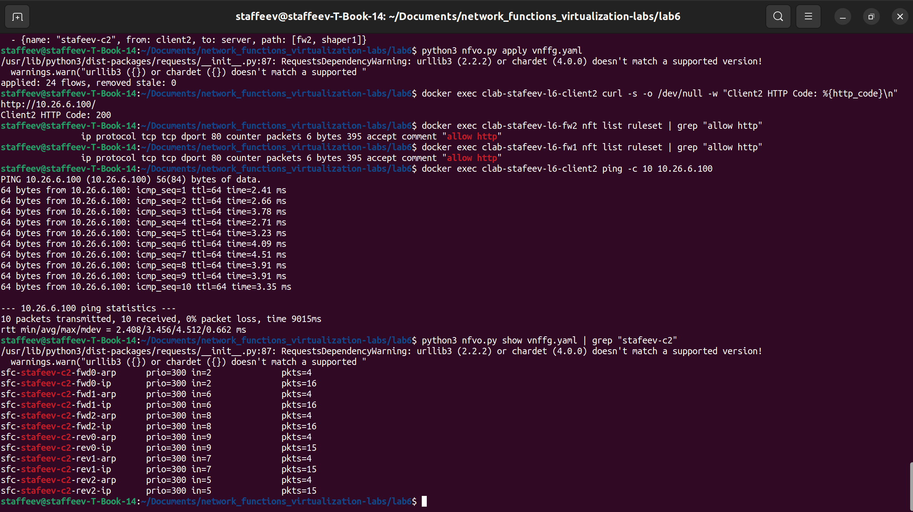

**Почему балансировка группой OpenFlow `select` опасна для stateful-VNF?**

Группа `select` распределяет пакеты между портами на основе хеша. При per-packet балансировке пакеты одного TCP-соединения могут попасть на разные экземпляры: например, SYN - на `fw1`, ACK - на `fw2`. У `fw2` не будет записи о состоянии соединения, поэтому пакет может быть отброшен как `invalid`. Для stateful-сервисов необходима per-flow балансировка по 5-tuple, чтобы весь поток проходил через один экземпляр.

В данной работе распределение выполнено на уровне VNFFG: `client1` и `client2` направлены на разные экземпляры FW, что сохраняет симметричность каждого потока.

---

# 5. Heal: отказ и восстановление

Для демонстрации отказоустойчивости смоделирован отказ `fw1` командой `docker stop clab-stafeev-l6-fw1`

После остановки контейнера ping от `client1` до `server` потерял 100% пакетов, тогда как `client2` продолжил работать через `fw2` (рисунок 15).

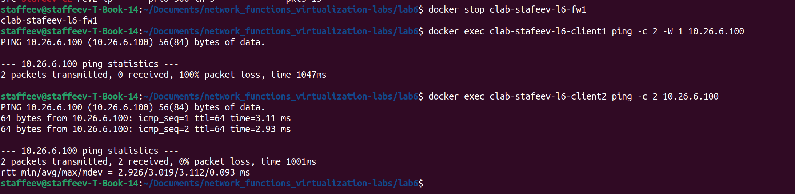

Ручное восстановление выполнено изменением `vnffg.yaml`: путь `stafeev-c1` заменён с `[fw1, shaper1]` на `[fw2, shaper1]`. После применения `python3 nfvo.py apply vnffg.yaml` ping от `client1` восстановился с 0% потерь.

Затем отказавший экземпляр удалён командой `./vnfm.sh terminate fw1 3 4`


Скрипт остановил контейнер, удалил veth-пары и снял порты `eth3`/`eth4` с моста `br0`. В результате остались `fw2` и `shaper1` (рисунок 16).

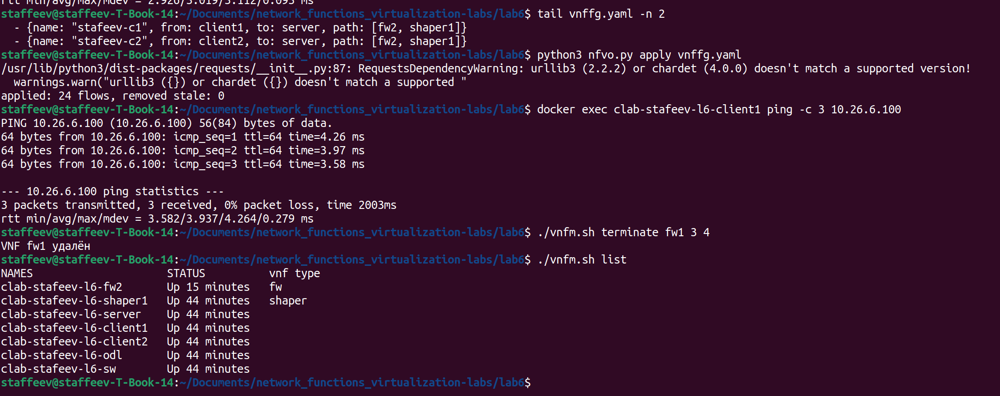

**Что в этом процессе нужно автоматизировать?**

Ручная последовательность «обнаружить отказ - изменить VNFFG - применить потоки - удалить отказавший экземпляр» должна быть заменена closed-loop automation. Необходимо автоматизировать обнаружение отказа через состояние порта или health-check VNF, запуск heal, переключение цепочки, перепрограммирование OpenFlow и восстановление или пересоздание экземпляра. Это позволяет сократить время восстановления с минут до секунд.

Для автоматического heal в `nfvo.py` добавлена команда `watch`. При запуске
`python3 nfvo.py watch vnffg_healing.yaml`
скрипт ищет VNF с полем `standby`; в данном случае это `fw1` с резервом `fw2`. Каждые 2 секунды выполняется проверка состояния контейнера через `docker ps`/`docker inspect` и состояния порта через RESTCONF operational-инвентаря ODL.

При обнаружении отказа скрипт модифицирует список `chains` в памяти, удаляет старые потоки с префиксом `sfc-` и заново программирует цепочку с портами резервного экземпляра.

Демонстрация автоматического heal показана на рисунке 17. В одном терминале запущен `watch`, в другом выполнен `docker stop clab-stafeev-l6-fw1`. Скрипт обнаружил отказ, вывел сообщение `FAILURE DETECTED`, переключил `stafeev-c1` на путь `[fw2, shaper1]` и перепрограммировал 24 потока. После этого ping от `client1` восстановился без ручного вмешательства.

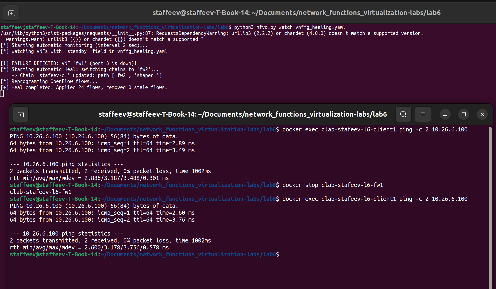

Воспроизводимость экспериментов обеспечена скриптами `deploy.sh` и `switch_vnffg.sh`. Скрипт `deploy.sh` выполняет уничтожение старой топологии, деплой, ожидание ODL, настройку плагинов и OVS, конфигурацию VNF, применение VNFFG и проверку связности. Целевой VNFFG задаётся параметром командной строки; при необходимости автоматически создаётся `fw2`.

Скрипт `switch_vnffg.sh` переключает конфигурацию цепочек без пересборки топологии: удаляет ненужные экземпляры VNF, создаёт требуемые и применяет новый VNFFG. Вывод `deploy.sh` подтверждает успешное развёртывание: ping проходит, HTTP возвращает код 200, порт 8026 блокирован, потоки OpenFlow имеют ненулевые счётчики (рисунок 18).

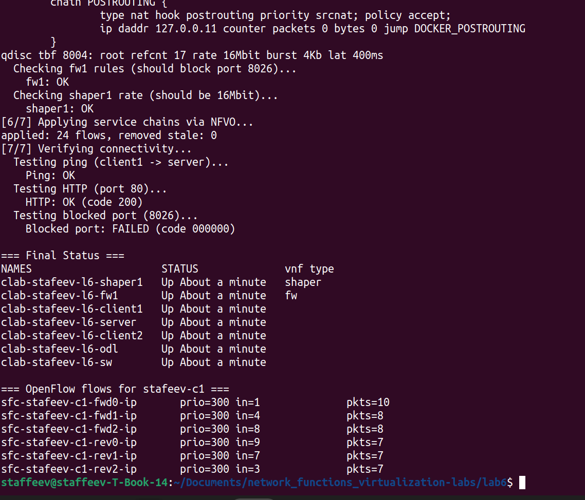

---

# 6. Производительность и ускорение

Пропускная способность цепочки измерена с помощью `iperf3` в режиме 4 параллельных потоков (`-P 4`) с обратным направлением передачи (`-R`). Суммарный результат составил 1.60 Гбит/с при 5245 ретрансмиссиях, скорость отдельных потоков - 366–423 Мбит/с (рисунок 19).

Полученный результат превышает лимит шейпера в 16 Мбит/с, поскольку `tbf` установлен на `eth2` и ограничивает трафик в сторону сервера. При использовании `-R` трафик идёт от сервера к клиенту через `eth1`, поэтому шейпинг не применяется. В прямом направлении трафик упирается в установленный лимит, что приводит к снижению скорости и обрыву control-сокета.

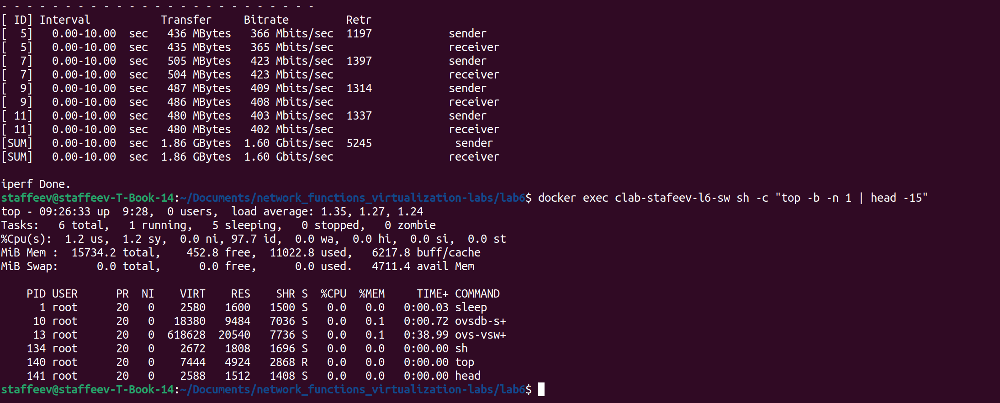

Снимок `top` внутри контейнера `sw` показывает около 0.4 с процессорного времени для `ovs-vswitchd` и load average хоста 1.3 при 97.7% простоя CPU. Следовательно, ограничение связано не с вычислительной мощностью, а с архитектурой обработки пакетов.

**Где «узкое место» в нашей NFVI и какие технологии NFV Acceleration его решают?**

Основное узкое место - многократные переходы между kernel и userspace. OVS в режиме `datapath_type=netdev` получает кадры через `AF_PACKET`, передаёт их в veth-пару, после чего ядро контейнера обрабатывает их через мост `br0`, `nftables`/`tc`. Затем кадр возвращается в OVS через вторую veth-пару. Для цепочки из двух VNF это приводит к нескольким переходам между пространствами памяти, копированиям, прерываниям и переключениям контекста.

Технологии NFV Acceleration уменьшают эти накладные расходы. DPDK реализует kernel bypass и обработку пакетов в user-space в режиме polling. OVS-DPDK использует этот механизм в datapath коммутатора. SR-IOV позволяет предоставить VNF виртуальную функцию NIC напрямую, минуя программный мост хоста. vhost-user использует разделяемую память между хостом и гостем и сокращает копирование. SmartNIC переносит часть сетевой обработки на аппаратный ускоритель.

Ускорение требует дополнительных ресурсов и усложняет эксплуатацию. DPDK и OVS-DPDK используют выделенные CPU и hugepages, SR-IOV зависит от возможностей конкретного оборудования и ограничивает количество VF, а vhost-user и SmartNIC усложняют оркестрацию и мониторинг. Кроме того, часть обработки становится недоступна стандартным средствам ядра, таким как `tc` и `nftables`. В учебной NFVI эти технологии не используются, что позволяет наглядно оценить накладные расходы программной обработки пакетов.

---

# Выводы

Финальный артефакт работы представлен на рисунке 20.

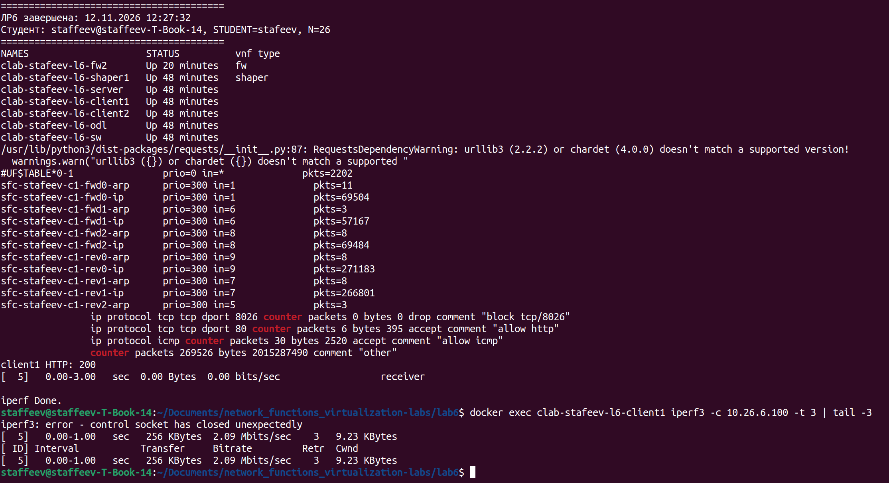

В ходе работы в среде Containerlab развёрнута NFVI с OVS в режиме userspace datapath и SDN-контроллером OpenDaylight, подключённым по OpenFlow 1.3. VNF описаны дескрипторами VNFD и настроены через скрипт-аналог VNFM: межсетевой экран на nftables блокирует TCP-порт 8026, а шейпер на основе `tc tbf` ограничивает скорость до 16 Мбит/с.

Трафик клиентов запрограммирован через NFVO по описанию VNFFG. Для каждого перехода цепочки созданы потоки IPv4 и ARP, обеспечивающие прохождение трафика через прозрачные VNF и симметричный обратный путь. Выполнены scale-out с созданием `fw2` и переносом цепочки `c2`, а также heal с переключением `c1` на резервный экземпляр после отказа `fw1`. Автоматический heal реализован командой `watch`, которая контролирует состояние контейнеров и портов ODL и перепрограммирует цепочку при отказе.

Проведён анализ производительности, выявивший влияние переходов между kernel и userspace. Рассмотрены технологии NFV Acceleration: DPDK, OVS-DPDK, SR-IOV, vhost-user и SmartNIC. Воспроизводимость экспериментов обеспечена скриптами `deploy.sh` и `switch_vnffg.sh`.

В результате получены практические навыки построения SFC, программирования OpenFlow через RESTCONF, описания VNF в терминах ETSI NFV MANO, выполнения операций instantiate, configure, scale-out, heal и terminate, а также автоматизации восстановления сервиса. Цель работы выполнена.
```